# Buttons, menus and power-on keys (firmware 2.05)

This is a reference for every key on the 121GW as stock firmware 2.05 handles it. It covers short and long presses at each dial position and in each function, the SETUP pages, the keys read at power-on, and the firmware-update and calibration backup procedures. It adds what the official manual (revision of 3 March 2025) leaves out.

Main findings:

- **Timing.** A short press acts when the key is released. A long press fires after about 0.5 s while the key is still held, and the release is then ignored.
  - HOLD has no long function: holding it cancels the press without a beep.
  - During the 2 s boot screen a key acts as soon as it is pressed.
- **Key combinations.** Besides the documented ones there are two more:
  - SETUP at power-on: factory mode.
  - HOLD + MEM held together during normal use: logging that records auto-hold captures instead of samples taken at the interval.
- **Persistent zero trim.** A long REL in a current function on its lowest range stores a zero trim in EEPROM. It survives power-off, nothing on the display shows it, and only a calibration-mode power-on clears it.
- **Traps:**
  - Holding a power-on key longer than 0.5 s also fires its long press. Holding MEM that long leaves a stray log file on the card.
  - After an SD calibration save or load, the result stays on the screen until the meter is switched off.
  - LCD contrast settings 0 and 1 are not kept.
  - The backlight has no timeout.

How each fact was established is marked:

- **[emu]**: run in the emulator on the stock 2.05 image, starting from a factory-default EEPROM image and a formatted card ([../tools/emu_run.py](../tools/emu_run.py), [../tools/button_map.py](../tools/button_map.py); screens decoded with [../tools/lcd_decode.py](../tools/lcd_decode.py)).
- **[code]**: read in the decompile (Key_ShortPress, Key_LongPress, Keys_Scan, Setup_*, BootScreen) and not run.
- **[meter]**: done on a production meter.
- **[manual]**: stated in the official manual.

## 1. Keys

The eight keys sit in two rows. The legends printed above or below a key name its second function:

| Key | Legend on the panel | Key code | Bluetooth remote number |
|---|---|---|---|
| RANGE | 15V diode | 0x10 | 1 |
| HOLD | AutoHOLD | 0x20 | 2 |
| REL | UP; 1kHz below | 0x40 | 3 |
| 1ms PEAK | DOWN; Bluetooth below | 0x80 | 4 |
| MODE (red) | backlight bulb below | 0x01 | 5 |
| MIN/MAX | | 0x04 | 6 |
| MEM | | 0x08 | 7 |
| SETUP (yellow) | | 0x02 | 8 |

How keys are read [code, emu]:

- **Scanning.** The keys are inputs PG8 to PG15, active low, scanned every 10 ms. A new state counts after two identical samples.
- **Short and long.** A short press is reported on release. A long press is reported after 50 ticks (about 0.5 s) while the key is held.
- **Lockout.** After a press there is a 10-tick lockout before the next one counts.
- **Two keys at once.** Pressing two keys together is ignored, except HOLD + MEM (0x28).
- **Auto-repeat.** In a SETUP edit and in the log recall view, holding REL or PEAK repeats it:
  - first repeat after 0.5 s (0.03 s in the recall view);
  - then five repeats 0.3 s apart;
  - then one every 0.1 s.
- **Beeps:**
  - One short beep (100 ms) means the press was accepted. Long presses give a 200 ms beep.
  - A **double beep** means the key does nothing here.
  - Every key beep restarts the auto power-off timer.
- **Bluetooth remote keys.** Bluetooth frames can press keys: `F4` followed by the key number as two ASCII digits, sent twice. "0n" is a short press of key n and "8n" a long one; the numbers are in the table above. A remote press goes through the same handlers as a real one, during the boot screen too [emu]. The frame layout is in [07-ble-packet.svg](../figures/07-ble-packet.svg).

## 2. Button map per dial position

The dial has eight function positions between its two OFF positions. OFF cuts the battery in hardware. The firmware calls the positions LowZ, V, mV, Hz, Ohm, VA, uA and A. The A position measures mA or A depending on which jack holds the lead.

| Position | MODE cycles through | Starts on |
|---|---|---|
| LowZ | (nothing: AC or DC is chosen automatically) | LowZ |
| V | DCV > ACV > ACV with AC+DC > DCV | DCV |
| mV | DCmV > ACmV > temperature (K thermocouple) > DCmV | DCmV |
| Hz | frequency > pulse width (ms) > duty cycle (%) > frequency | frequency |
| Ohm | resistance > continuity > diode > capacitance > resistance | resistance, top range |
| VA | DC VA > AC VA (mA or A side by the jack) | DC VA |
| uA | DC uA > AC uA > DC uVA > AC uVA > DC uA | DC uA |
| A | DC > AC (mA or A by the jack; switches by itself when the lead moves) | DC A |

Each position remembers its last function in EEPROM (0x08-0x0E) [code]. Turning the dial clears HOLD, MIN/MAX, REL, PEAK and the low-pass filter [code].

Each figure shows one position's panel with the short and long action of every key. Where the functions within a position differ, each function is named. Gray italic marks a press that is rejected.

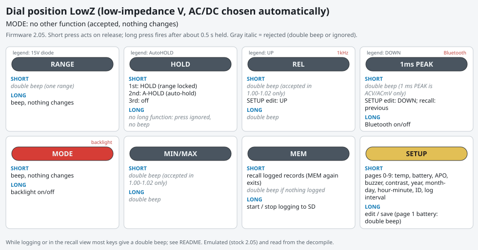 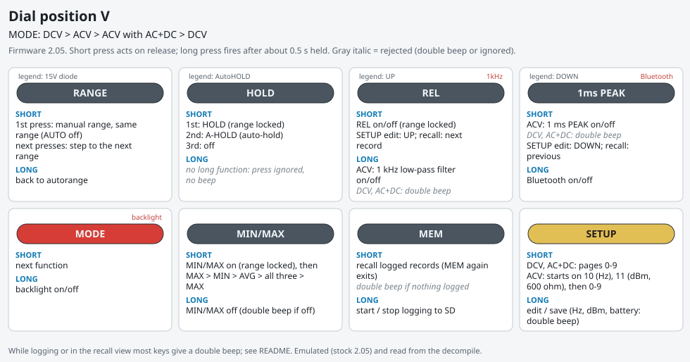 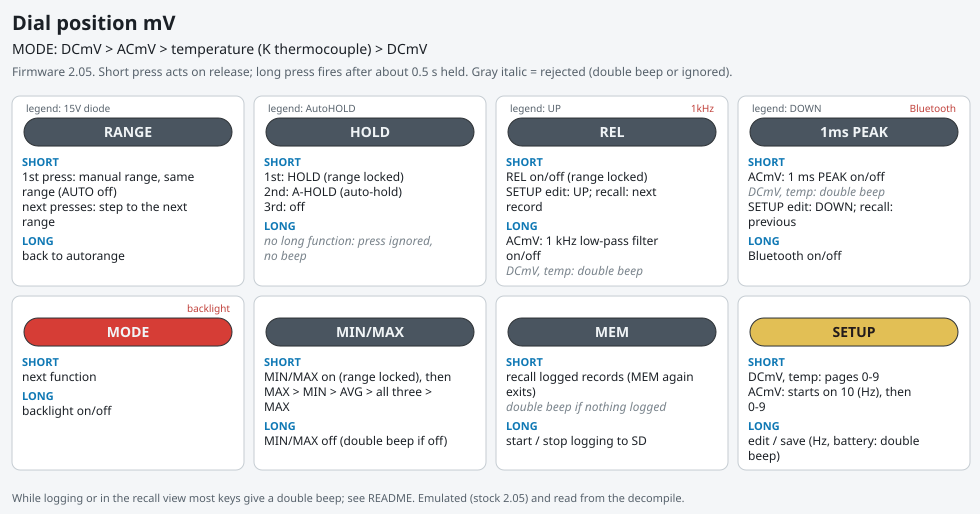 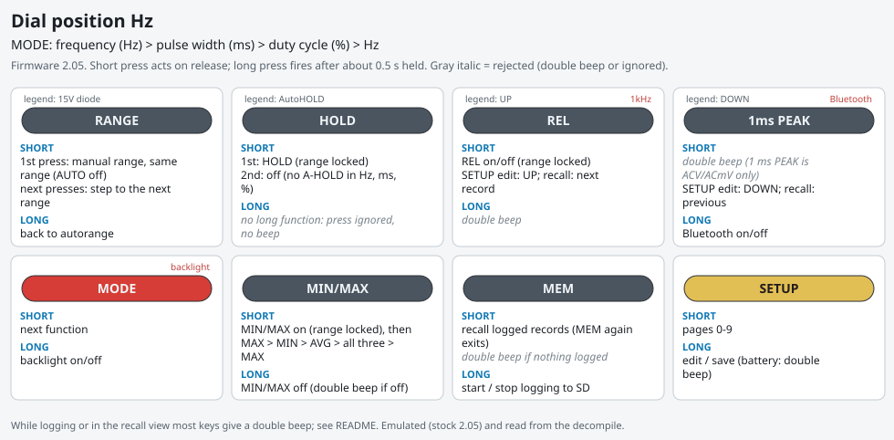 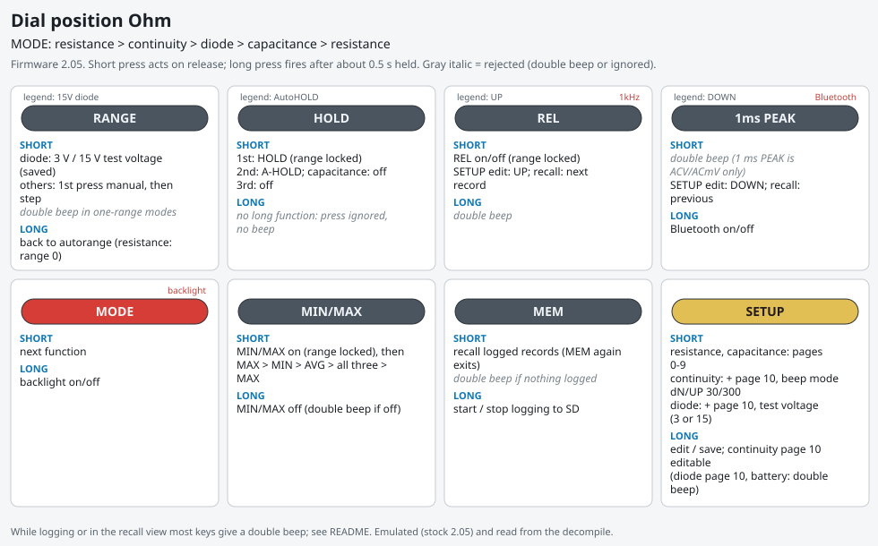 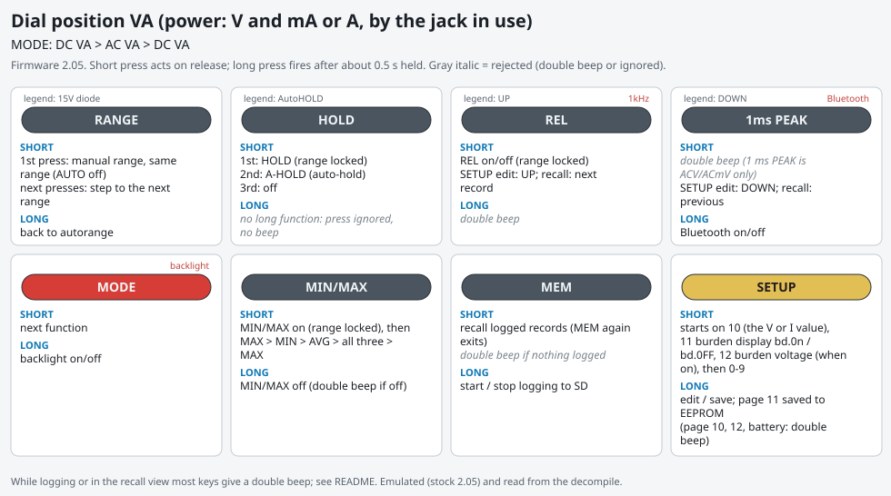 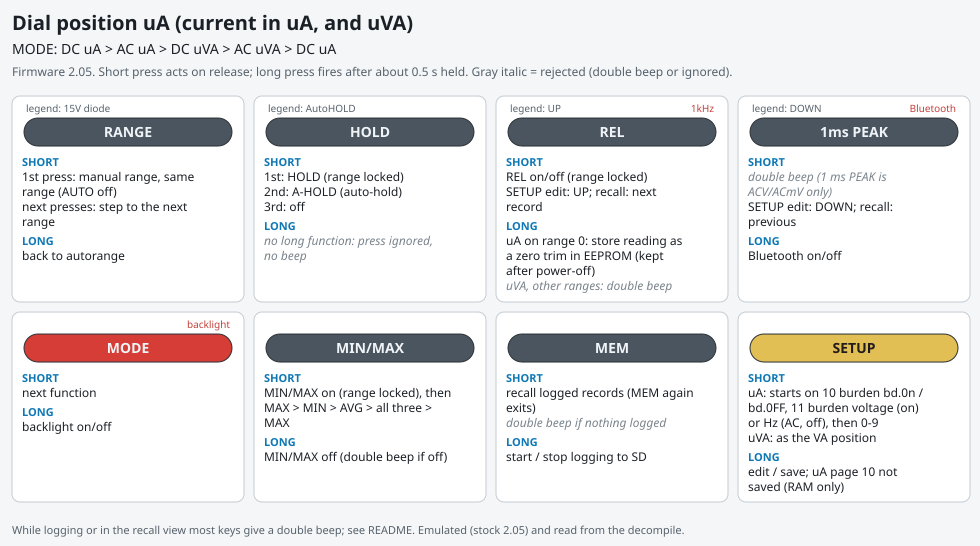 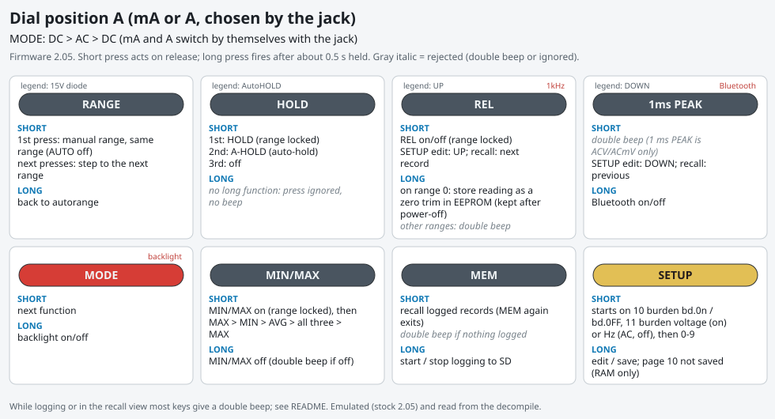

### Details common to all positions

**RANGE** [code, emu]:

- The first short press in autorange only switches to manual (the AUTO icon goes off) and keeps the range. Each later press steps to the next range and wraps around.
- A function with a single range gives a double beep.
- RANGE is refused while HOLD, auto-hold or MIN/MAX is on, and while logging.
- A long press returns to autorange on range 0.
- In diode mode a short RANGE switches the test voltage between 3 V and 15 V (saved in EEPROM 0x12) and shows it on the sub display.

**HOLD** [code, emu]:

- The first press holds the reading and locks the range.
- The second press turns on auto-hold (A-HOLD), except in frequency, pulse width, duty cycle and capacitance, where it turns HOLD off.
- The third press turns auto-hold off.
- Auto-hold freezes the digits while the bargraph stays live. It captures a new value, with a beep, when two successive readings agree within 20 counts and differ from the held value by more than 400 counts. Readings of 999 counts or less are never captured.

**MIN/MAX** [code, emu]:

- The first press starts recording and locks the range. The next presses show MAX, MIN, AVG, then all three at once (live reading).
- A long press ends MIN/MAX.
- It is refused in LowZ, in auto-hold, with 1 ms PEAK on, and in calibration mode.
- While MIN/MAX is on, auto power-off does not count down and RANGE is refused.

**REL** [code, emu]:

- A short press stores the present reading as the reference and locks the range. The next press turns REL off.
- It is refused in LowZ (accepted only in 1.00-1.02).
- A long press:
  - in ACV and ACmV, turns the 1 kHz low-pass filter on or off. It is refused in AC+DC.
  - in the uA, mA and A functions on range 0, stores the zero trim (section 6).
  - anywhere else, gives a double beep.

**1ms PEAK** [code, emu]:

- A short press turns on 1 ms peak capture in ACV and in ACmV. The manual says VAC only. Peak capture turns MIN/MAX off.
- A long press switches Bluetooth on or off (the BT icon). Bluetooth is always off after power-on.

**MODE:**

- A long press switches the backlight on or off [manual].
- No timer turns the backlight off again [code]: it stays on until the next long MODE press, auto power-off or the OFF position. The code writes a 120 to a variable when the light goes on, but nothing reads that variable.

**MEM:**

- A long press starts or stops logging to the SD card [manual].
- A short press opens the **recall view** of the logged samples [code]:
  - it shows the 60-row RAM ring the logger fills, not the card;
  - REL steps to the next record and PEAK to the previous one;
  - MEM again goes back to live readings;
  - with nothing logged it gives a double beep.
- Starting a log clears HOLD, REL and MIN/MAX and locks the range [emu].

**HOLD + MEM held together for 0.5 s** [code; not run]:

- Starts logging with auto-hold on. In this mode the interval timer is idle: a row is stored each time auto-hold captures a new value.
- The same combination ends it.
- The manual does not mention it. It is the same pair of keys the bootloader reads for a firmware update, but used after power-on.

### Keys while logging, in the recall view, and in a SETUP edit [code]

| State | Accepted | Double beep |
|---|---|---|
| Logging (MEM icon, sub display counts rows) | long MEM (stop), long MODE, long PEAK, short REL, short PEAK | short MODE, SETUP short and long, MIN/MAX, short HOLD, RANGE short and long, short MEM, long REL |
| Recall view | REL / PEAK (step through records; held, they repeat instead of giving a long press), short MEM (leave), long MODE | short MODE, SETUP, MIN/MAX, HOLD, RANGE |
| SETUP edit (value blinks) | REL = up, PEAK = down (held, they repeat), long SETUP (save), short SETUP (meter ID: next digit), long MODE | (no long REL or long PEAK while editing) |

## 3. SETUP pages

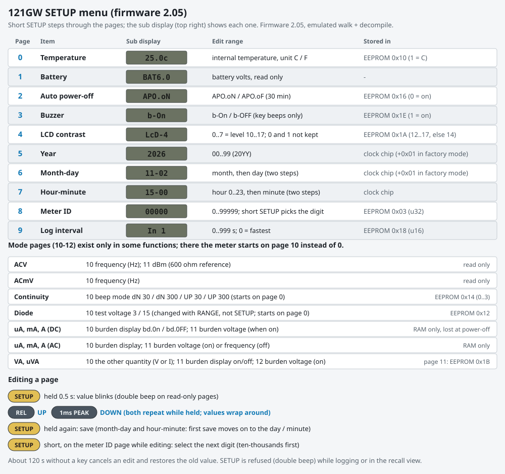

A short SETUP press moves to the next page. The sub display (top right) shows the page.

Editing a page:

1. Hold SETUP for 0.5 s; the value blinks.
2. Use REL (UP) and PEAK (DOWN) to change it. Values wrap around at both ends.
3. Hold SETUP again to save. A long SETUP on a read-only page gives a double beep.

Pages 0-9 exist in every function [emu: SETUP walk in every position and sub-function]:

| Page | Shows | Edit | Stored |
|---|---|---|---|
| 0 | internal temperature, ` 25.0c` | C / F | EEPROM 0x10 |
| 1 | battery, `BAT6.0` (volts, one decimal) | read only | |
| 2 | auto power-off, `APO.oN` / `APO.oF` | on / off | EEPROM 0x16 (0 = on) |
| 3 | buzzer, `b-On` / `b-OFF` | on / off | EEPROM 0x1E |
| 4 | contrast, `LcD-n` | n = 0..7 (controller level 10..17) | EEPROM 0x1A |
| 5 | year, ` 2026` | 00..99 | clock chip |
| 6 | month-day, `11-02` | month, then day | clock chip |
| 7 | hour-minute, `15-00` | hour, then minute | clock chip |
| 8 | meter ID, `00000` | 0..99999, digit by digit | EEPROM 0x03 |
| 9 | log interval, `In  1` | 0..999 s (0 = fastest, about 200 ms per the manual) | EEPROM 0x18 |

Mode pages [emu, code]:

| Function | Page 10 | Page 11 | Page 12 | Starts on |
|---|---|---|---|---|
| ACV | frequency (read only) | dBm, 600 ohm reference (read only) | | 10 |
| ACmV | frequency (read only) | | | 10 |
| continuity | beep mode `dN 30`, `dN 300`, `UP 30`, `UP 300` (EEPROM 0x14) | | | 0 |
| diode | test voltage `3` or `15` (set with RANGE) | | | 0 |
| DC uA, mA, A | burden display `bd.0n` / `bd.0FF` (not saved) | burden voltage, when on | | 10 |
| AC uA, mA, A | burden display (not saved) | burden voltage when on, otherwise frequency | | 10 |
| VA, uVA | the other quantity (V or I) | burden display on/off (EEPROM 0x1B) | burden voltage, when on | 10 |

Details the manual does not give [code]:

- **Contrast 0 and 1 are not kept.** The edit range is 10..17 (shown as 0..7), but the power-on loader accepts only 12..17 and falls back to 14. A saved 0 or 1 comes back as 4 at the next power-on.
- **Meter ID** is edited digit by digit. Editing starts on the ten-thousands digit; REL and PEAK change that digit, and a short SETUP moves to the next digit (wrapping from the units back to the ten-thousands).
- **Month-day and hour-minute take two steps.** The first long SETUP saves the month (or hour) and moves straight to the day (or minute), still blinking; the second saves it. The day is clamped to the month's length using the Gregorian leap rule. Year, date and time go to the clock chip when saved.
- **Edit timeout.** About 120 s without a key cancels the edit and restores the value from before the edit.
- **The current burden display (page 10) is not saved**: it is off again after power-off. The VA burden display (page 11) is saved.
- **The buzzer setting silences only key beeps.** Continuity, diode, the auto-hold capture beep, the high-voltage warning and the auto power-off warning sound anyway [emu]. Firmware 1.04-1.09 silenced continuity too ([09-version-timeline.svg](../figures/09-version-timeline.svg)).
- **Auto power-off** is 30 minutes without a key, and its icon is `APO`:
  - The timer does not count during MIN/MAX or logging.
  - For the last 60 s the APO icon blinks, and at 60 s the meter gives five 500 ms beeps, one a second, even with the buzzer off.
  - Then it shows `-oFF-` and sleeps. Turning the dial wakes it and the meter starts again from the boot screen [code; sleep, wake and `-oFF-` emu].

## 4. Power-on key combinations

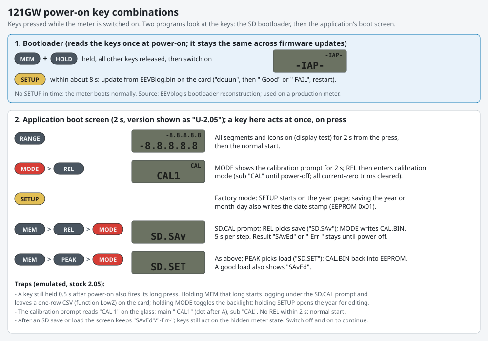

Two programs look at the keys at power-on.

**1. The SD bootloader** (0x08000000; a firmware update never replaces it). It reads the keys once:

- With **MEM + HOLD** held and every other key released, it shows `-IAP-` on both rows. It then waits about 8 s for **SETUP**, which starts the update.
- Otherwise it starts the application.
- Sources: EEVblog's bootloader reconstruction (key pins PG11 + PG13, then PG9, which Keys_Read maps to MEM, HOLD and SETUP) [code]; used to flash a production meter [meter].

**2. The application's boot screen** shows the version (`U-2.05`, the 7-segment V) for 2 s. A key pressed during those 2 s acts at once:

| Keys | Screen | Effect | Evidence |
|---|---|---|---|
| RANGE | everything lit | Display test: every segment and icon on. The 2 s restart from the press. | emu |
| MODE, then REL within 2 s | ` CAL1` / sub `CAL` | **Calibration mode** until power-off. The sub display shows `CAL`, autorange is off, and all six current-zero trims are cleared. Without REL the meter starts normally. | emu, manual |
| SETUP | | **Factory mode**: the SETUP walk starts on the year page. Saving the year or month-day also writes the manufacturing date stamp (EEPROM 0x01, YYMM; it appears in the CSV `ID` line). Otherwise the meter is normal. | code, emu |
| MEM, then REL or PEAK, then MODE | `SD.CAL`, `SD.SAv` / `SD.SET` | Calibration file save or load (section 5) | emu, manual, meter (save) |

**Trap: holding a boot key too long** [emu]. A key still held 0.5 s after power-on also produces its long press:

- **MEM:** starts logging under the `SD.CAL` prompt (the MEM icon appears). It stops again when the boot screen ends, leaving a one-row CSV whose function reads LowZ.
- **MODE:** toggles the backlight.
- **SETUP:** opens the year for editing in factory mode.

The manual's "hold MEM, turn on, release MEM" is safe when MEM is released quickly.

## 5. Firmware update, calibration backup and restore

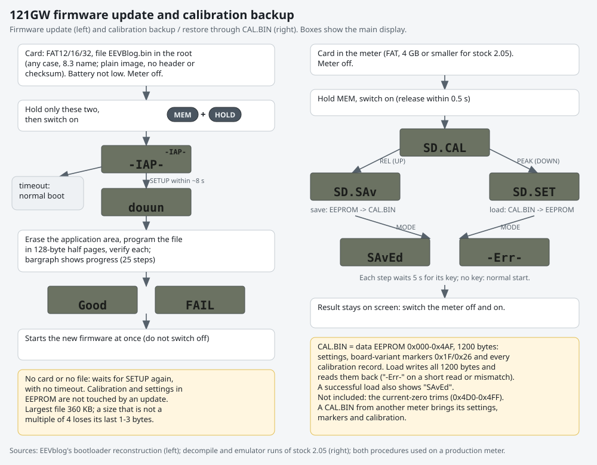

### Firmware update

1. Copy `EEVBlog.bin` to the root of a FAT12/16/32 card. The name is matched as an 8.3 name in any case. The file is a plain image with no header or checksum.
2. Make sure the low-battery icon is off, then switch the meter off.
3. Hold **MEM + HOLD**, switch on, and release them.
4. When `-IAP-` appears, press **SETUP** within about 8 s.
5. The display shows `douun`, the bargraph shows progress, and then ` Good` or ` FAIL`. The new firmware then starts by itself.

Things to know [code; EEVblog bootloader reconstruction]:

- The data EEPROM (settings and calibration) is not touched.
- With no card or no file, the bootloader waits for SETUP again with no timeout.
- The largest usable file is 360 KB, and only whole 4-byte words are written.
- A meter that has run 2.05 once has brown-out reset turned off in its option bytes. The bootloader also does this.

### Calibration backup (save to CAL.BIN)

1. Put a card in the meter. For stock 2.05 use a card of 4 GB or less: past 4 GiB the addresses wrap ([08-log-and-sd-layout.svg](../figures/08-log-and-sd-layout.svg)).
2. Hold **MEM**, switch on, and release MEM straight away (see the trap in section 4). The display shows `SD.CAL`.
3. Press **REL** (UP). The display shows `SD.SAv`.
4. Press **MODE**. The meter writes `CAL.BIN` and shows `SAvEd`, or `-Err-` if it failed.
5. Switch the meter off and on. The result stays on the screen until then, and keys pressed meanwhile act on the meter state behind it [emu].

Each prompt waits 5 s for its key; with no key the meter starts normally [code].

### Calibration restore (load from CAL.BIN)

The steps are the same, with **PEAK** (DOWN) instead of REL: the display shows `SD.SET`, then MODE loads the file.

- A successful load also shows `SAvEd` [emu].
- The load writes all 1200 bytes and reads them back, and shows `-Err-` on a short file or a mismatch.

What the file holds [code, emu]:

- `CAL.BIN` is the first 1200 bytes of the data EEPROM, 0x000-0x4AF: all settings, the board-variant markers 0x1F/0x26 and every calibration record.
- A restore therefore also brings back the settings saved with it. A file from another meter brings that meter's settings, markers and calibration.
- The **current-zero trims (0x4D0-0x4FF) are not in the file.**

## 6. Calibration mode and the current-zero trim

Calibration mode (MODE, then REL, at power-on) changes some keys [code, emu]:

| Key | In calibration mode |
|---|---|
| SETUP short | arm the offset capture for this function and range. Double beep where the range has no calibration (LowZ, pulse, duty; Hz, diode and capacitance above range 1). |
| MEM short | arm the gain capture (only after the offset capture) |
| MEM long | Ohm range 6: its extra linearity trim (EEPROM 0x178). Elsewhere: the internal temperature trim, which sets the present reading to 23.00 C (EEPROM 0x2E0). Not in the manual. |
| RANGE short | steps the range on the first press (no manual-only first press) |
| RANGE long | beep, the range does not change |
| MIN/MAX | double beep |

Expected inputs:

- AC calibration is a two-point fit: the offset step at 10% of full scale and the gain step at full scale. Both need a reference frequency in the accepted window.
- The manual's reference table gives the values for each range.

**Current-zero trim** [emu]:

- A long REL in any uA, mA or A function on range 0 stores the present reading as a zero for that function, in EEPROM 0x4D0 + 8 x slot. It works outside calibration mode.
- It is subtracted on range 0 from then on, across power cycles.
- No icon shows that a trim is active.
- Only a calibration-mode power-on clears it.
- Stock 2.05 has a bug here: a second long REL stores the leftover (about 0) instead of the sum, so after the next power-on the first zero is lost.

## 7. Other behavior not in the manual

- **Lead in a current jack while the dial is not on a current position:** the main display shows ` LEAD`. With the dial on A, moving the lead between the mA and A jacks switches the function by itself [code, emu].
- **Voltage warnings:** the high-voltage icon from 30 V. From 600 V (or OL on the 600 V range) the meter beeps 500 ms every other half second [code].
- **Settling after a change:** for a few display updates after a function or range change the display shows 0 while the new range settles: ACV 3 updates, ACmV 4, LowZ DC and 1 ms PEAK 5 [code].
- **LowZ:** AC or DC is picked automatically. AC+DC in the V position alternates AC and DC readings and shows the root sum of squares [code].
- **VA** shows `-----` before its first reading. The power shown is \|V\| x \|I\|, so negative power never shows [code].

## Reproducing

- Key sequences: `tools/emu_run.py IMAGE SVD --eeprom factory-eeprom.bin --rotary V --keys "2500:SETUP:800,..." --screens ...` ([../tools/emu_run.py](../tools/emu_run.py)). A key is `T_MS:KEY[:HOLD_MS]`, with the hold time defaulting to a short press.
- The full per-position map: [../tools/button_map.py](../tools/button_map.py).
- Boot keys, SETUP walks in every sub-function, edits and SD save/load: the version probe suite [../tools/versions/probe.py](../tools/versions/probe.py), which also compares all 21 published releases.
- Not run in the emulator: the HOLD + MEM logging combination, calibration-mode long MEM, and the backlight. Those rows come from the decompile only.
