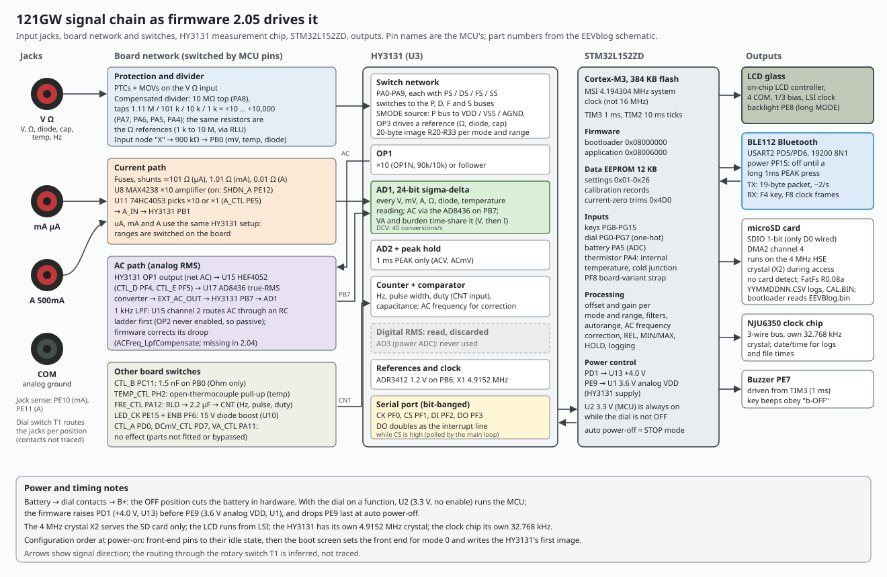

# Firmware 2.05 architecture: reset to reading

How stock firmware 2.05 is put together: the startup chain from reset to the main loop, the two timer interrupts that pace everything, the main loop and its flags, the per-mode measurement handlers, the measurement core from an HY3131 conversion to the digits on the glass, the display and key state machine, and the data-EEPROM settings with their boot-time loaders.

Main findings:

- The application starts at 0x08006000 behind a 24 KB SD bootloader. It runs at 4.194304 MHz (MSI), not the 16 MHz `SystemInit` sets up; every tick and delay loop depends on that.
- There is no RTOS and no SysTick: a 1 ms TIM3 interrupt and a 10 ms TIM2 interrupt set flags, and one main loop polls the HY3131's interrupt line and acts on the flags.
- A DC reading is the AD1 result, block-averaged (16 conversions in DCV: 2.5 results per second), calibrated as `trunc((average - offset) / gain + 0.5)`, smoothed by a stability filter and autoranged at +10% / 10% of full scale.
- Negative readings come out 2 counts toward zero (an off-by-one in the 24-bit sign conversion plus rounding that truncates toward zero), and a blank calibration record reads 0 everywhere.
- Every EEPROM setting is range-checked with a default at boot, so a blank EEPROM boots with defaults.

How each claim was established: **[code]** read in the decompile ([../decompile/d205-g122.c](../decompile/d205-g122.c)), **[emulated]** run in our emulator ([../tools/emu_run.py](../tools/emu_run.py)) with the HY3131 model feeding chosen AD1 values, **[library]** IAR runtime helpers identified by calling them ([../tools/emu_call.py](../tools/emu_call.py)), **[meter]** on a production meter. Addresses are flash addresses in 2.05.

Related: [../hardware/board.md](../hardware/board.md), [../hardware/hy3131.md](../hardware/hy3131.md), [calibration.md](calibration.md), [storage.md](storage.md), [bluetooth.md](bluetooth.md).

## 1. Startup chain

| Step | Function | What it does | Evidence |
|---|---|---|---|
| 0 | SD bootloader (0x08000000-0x08005FFF) | turns BOR off if needed, offers the update prompt (MEM + HOLD at power-on, then SETUP, loads `EEVBlog.bin` from the card), otherwise jumps to the application's reset vector | EEVblog's bootloader reconstruction |
| 1 | `Reset_Handler` 0x08029174 | `SystemInit()`, then `__iar_program_start()` | code |
| 2 | `SystemInit` 0x08025f70 | RCC to reset state, `SetSysClock` (HSE x12 / 3 = 16 MHz PLL), then **VTOR = 0x08000000** (the bootloader's table) | code, emulated |
| 3 | `__iar_data_init3` | zero 0x6EBC bytes at 0x20001240, unpack 0x348 bytes of initialized data to 0x20000000 | code |
| 4 | `main` 0x08024b40 | `NVIC_SetVectorTable(0x08000000, 0x6000)`: VTOR = 0x08006000 | code, emulated |
| 5 | `Board_Init` 0x0801be76 | standby-wake flag; **BOR off** in the option bytes (resets once if it was on); voltage range 1 (waits VOSF); `Board_ClockSelect(0)`: **MSI 4.194304 MHz**, HSE off; `Board_RTCClockInit`: LSI on, RTC/LCD clock = LSI; debug kept in low power; `Board_GPIOInit` (+4.0 V, then 3.6 V analog VDD, front end to its idle state, HY3131 lines idle); analog pins; ADC on; NVIC; TIM2 and TIM3 | code, emulated |
| 6 | `Board_ProbePF8` | board-variant strap ([../hardware/board.md](../hardware/board.md) section 9) | code |
| 7 | `App_StateInit` 0x08024de0 | clock from the clock chip, the two variant markers, calibration record 200, every setting (section 7), APO countdown 1800 s; measurement state zeroed | code |
| 8 | `Board_LCDInit(contrast, 1)` | LCD controller; waits for ENS and RDY with no timeout | code |
| 9 | `BootScreen` 0x0800ea3a | front end for mode 0, "V-2.05" drawn, a 2000 ms countdown, **`HY_SetMode(5, 0)`: the HY3131's first configuration**, boot-key handling until the countdown ends | code, emulated |
| 10 | main loop | section 3 | code, emulated |

In the emulator the main loop starts at 2015 ms after reset: the boot screen is exactly the 2000 ms TIM3 countdown **[emulated]**.

**Boot keys [code, emulated].** During the boot screen a key press fires at once (normally on release), so a tap is enough:

| Key at power-on | Action |
|---|---|
| RANGE | all segments on |
| MODE, then REL | calibration mode ([calibration.md](calibration.md)) |
| SETUP | factory mode (manufacturing date stamp editable) |
| MEM | SD calibration file: REL = save, PEAK = load, MODE confirms ([storage.md](storage.md)) |

Bluetooth key frames work here too. An SD result on screen holds the boot screen until a key is pressed.

## 2. Interrupts and timing

| IRQ | Handler | Priority (preempt/sub) | Job |
|---|---|---|---|
| 45 SDIO | SD driver | 0/0 | SD transfers |
| 53 DMA2 ch4 | SD DMA | 0/0 | SD data |
| 29 TIM3 | `TIM3_IRQHandler` | 1/1 | every 0.996 ms: 1 ms tick, `g_ms_countdown`, buzzer pattern on PE7 |
| 28 TIM2 | `TIM2_IRQHandler` | 2/2 | every 10.02 ms: `g_tick10ms`, countdowns, a 50-tick (500 ms) cycle: build the Bluetooth packet at tick 40, send it at tick 50 |
| 38 USART2 | `USART2_IRQHandler` | enabled by `BLE_Start` only | Bluetooth: one TX byte per interrupt, RX frame assembly |
| SysTick | | | unused: its handler decrements a counter nothing sets; stopped before STOP |

Both timers use a /261 prescaler: TIM2 period 161 (10.02 ms), TIM3 period 16 (0.996 ms), exact only at 4.194304 MHz **[code]**. Without either interrupt the meter stays on the boot screen forever (the emulator reproduced this before it delivered timer interrupts).

TIM2 also: every 10th tick sets a once-per-100 ms flag; in Hz/pulse/duty clears a stale reading after 3 s without a counter result; in AC modes clears the frequency after 20 s without one; in logging at interval 0 queues a row every 16 ticks, at most 5 per second **[code]**.

## 3. The main loop

`main` never returns. Each pass **[code]**:

1. `HY_Poll`: if the HY3131's DO line (PF3) is high, service the chip and dispatch its conversion handlers ([../hardware/hy3131.md](../hardware/hy3131.md) section 4).
2. If a new display value is ready: `Display_Update` (autorange and the display steps); in LowZ also the automatic AC/DC decision.
3. `LCD_RefreshDirty`: redraw the parts flagged dirty and flush.
4. On the 10 ms tick: `Rotary_Poll`, `Keys_Process` (scan, dispatch, then any pending Bluetooth key), `Jack_Poll`, the AC counter gate alternation, the VA sub-display alternation, `RTC_PollSeconds`.
5. Every 100 ms: read the clock, the battery or thermistor in turn, take a record snapshot.
6. At TIM2 tick 40 with Bluetooth on: build the 19-byte packet ([bluetooth.md](bluetooth.md)).
7. While a SETUP edit is open, every 500 ms: the edit timeout (about 120 s without a key cancels the edit).
8. Once a second (clock chip seconds changed): logging interval, APO countdown (not while MIN/MAX or logging is on; blink and five beeps in the last 60 s).
9. Logging: store a row in the 60-row RAM ring; when the ring is full, write it to the card ([storage.md](storage.md)).
10. A received Bluetooth frame: `BLE_ProcessRx`.
11. A pending mode or range change: `Mode_ApplyChange`.
12. APO expired: `App_Sleep` (STOP; a dial turn re-runs steps 5-9 of section 1).

## 4. Modes and per-mode handlers

`g_mode` numbers (also sent over Bluetooth):

| # | Mode | # | Mode | # | Mode |
|---|---|---|---|---|---|
| 0 | LowZ | 9 | Ohm | 17 | DC uA |
| 1 | DCV | 10 | continuity | 18 | AC mA |
| 2 | ACV | 11 | diode | 19 | DC mA |
| 3 | DCmV | 12 | capacitance | 20 | AC A |
| 4 | ACmV | 13 | AC VA (uA) | 21 | DC A |
| 5 | temperature | 14 | AC VA (mA) | 22 | DC VA (uA) |
| 6 | Hz | 15 | AC VA (A) | 23 | DC VA (mA) |
| 7 | pulse width | 16 | AC uA | 24 | DC VA (A) |
| 8 | duty | | | | |

MODE cycles within the dial position (`Mode_Cycle`): DCV -> ACV -> ACV AC+DC -> DCV; DCmV -> ACmV -> temperature; Hz -> pulse -> duty; Ohm -> continuity -> diode -> capacitance; the current positions alternate AC and DC; the jack sense swaps A and mA modes by itself. The last mode per dial position is saved in EEPROM 0x08-0x0E **[code]**.

`HY_OnAD1` (0x080061e4) converts and averages AD1, then dispatches by mode **[code]**:

| Mode | Handler | Notes |
|---|---|---|
| 0 LowZ | `Mode_LowZ_OnAD1` | DCV handler, or ACV while automatic AC is active; shows 0 for 5 display updates after a signal appears |
| 1 DCV | `Mode_DCV_OnAD1` 0x08007714 | calibration, stability filter (2, 2), display; the per-sample fast path feeds the bargraph |
| 2 ACV, 4 ACmV | 0x08006aec, 0x080069b4 | AD1 reads the AD8436 output; AC offset, **negatives clamped to 0**, gain, frequency-response correction, 1 kHz filter compensation (2.05 only), filter (20, 10) |
| 2 ACV AC+DC | ACV and DCV handlers alternating | 5 AC / 3 DC readings; shows sqrt(AC^2 + DC^2), OL if either part exceeds 60,000 |
| 3 DCmV | 0x080077f0 | filter (5, 10): steadier and slower than DCV |
| 5 temperature | 0x08007840 | DCmV handler (thermocouple mV) + cold junction, K-type table -200 to 1350 C in 0.01 C, F conversion |
| 9 Ohm | 0x080079c4 | negatives -> 0 except range 0; filter per range: r0 (100,10), r1 (20,10), r2 (10,10), r3 (20,10), r4 (20,10), r5 (10,5), r6 (100,20); range 5/6 software corrections on variant meters |
| 10 continuity | 0x080078b8 | Ohm handler; the beeper decides on the per-sample reading |
| 11 diode | 0x08007e84 | 15 V option reads /10; variant fix +500 counts (PF8 low, 15 V, reading > 14,000); beep under 1000 counts and on a jump over 1000 |
| 12 capacitance | `HY_Poll` extra 0x0800b540 + counter | on a completed measurement forces the range up (< 2 -> 2, < 5 -> 5) |
| 6, 7, 8 Hz, pulse, duty | `HY_OnCounter` 0x0800aa00 | frequency 0x0800ac1c, pulse width 0x0800b070, duty 0x0800b2d8 |
| 17, 19, 21 DC current | 0x08007fa8 | with burden display on, AD1 alternates current and burden voltage every 4 displays |
| 16, 18, 20 AC current | 0x0800664a | same, every 7 displays |
| 13-15 AC VA | 0x08008b8c | AD1 alternates V (ACV handler) and I, swapping after 3 / 6 displays; power = abs(V) x abs(I), so negative power never shows |
| 22-24 DC VA | 0x080084e0 | same with the DCV handler |
| 1 ms PEAK (ACV, ACmV) | `HY_OnPeak` 0x0800a7fc | the HY3131's peak hold (PKHMAX/PKHMIN), re-armed by two R29 writes |

There is one measurement ADC, so burden voltage and VA time-share it and update more slowly than plain V or A. The HY3131's power ADC (AD3) and its digital RMS result are not used.

## 5. Measurement core: from a conversion to the display

Traced end to end for DCV; the other modes share the frame **[code; emulated where marked]**:

1. **Read.** `HY_Service` reads all 52 HY3131 registers on the interrupt, every 25 ms in DCV **[emulated]**.
2. **Sign.** `HY_AD1Signed` (0x080062f8): `raw > 0x800000 ? -(0xFFFFFF - raw) : raw`. Off by one: -1 count reads 0, every negative value is 1 count high, and 0x800000 reads +8,388,608.
3. **Average.** `HY_AD1Average` (0x08006342): blocks of 16 in DCV, DCmV and DC current, 8 in Ohm (none on range 5), so a DCV result every 16 x 25 ms = 400 ms.
4. **Calibrate.** `Cal_Apply` (0x08006418): `reading = trunc((average - offset) / gain + 0.5)` with offset and gain from the record for the mode and range ([calibration.md](calibration.md)). `trunc(x + 0.5)` rounds negatives toward zero. A gain of 0 gives 0.
5. **Filter.** The stability filter (0x0800b754, value, threshold, n) keeps a running mean of up to n values and restarts when the value jumps by more than the threshold. (zombu4's review notes that the newest value is written before the history shifts, so it counts twice.)
6. **Display.** A new value sets `g_display_update`; the main loop runs `Display_Update` (0x0800dcfc): autorange, then the display steps (high-voltage warning, settle counter, decimals and units, bargraph, OL).
7. **Fast path.** On every conversion, 0x080064d6 applies offset and gain to the unaveraged value (`g_reading_fast`), which drives the bargraph and is what logging and records store **[code + emulated]**.

**Results with chosen inputs [emulated]** (DCV, offset 0, gain 1.0):

| AD1 | Displayed | Why |
|---|---|---|
| 30000 | 30000 | exact |
| -30001 | -29999 | sign conversion +1, then truncation toward zero +1 |
| 60000 | range up, 0 while settling, then the reading | above 55,000 |

With a production meter's calibration (gains about 61 raw counts per DCV count), +1,220,800 reads 2.0000 V and -1,220,800 reads -1.9998 V **[emulated with real calibration data]**.

**Autorange (0x0800de24) [code, emulated].** Full scale per mode and range comes from a table at 0x08025a3c: 50,000 in most ranges; 6,000 for the 600 V ranges and LowZ; 990 for duty; 25,000 for VA; 99,999 for frequency. Up-range when abs(reading) > FS + FS/10 (FS/12 after an overload), down-range when < FS/10 (capacitance range 5: FS/100; current range 2: x5). Only with MIN/MAX off, manual range off, more than one range, and HOLD off or auto-hold on. After a change the settle counter discards the next few display updates (ACV 3, ACmV 4, LowZ DC or PEAK 5) and the display shows 0 meanwhile. Emulated: DCV at 60000 counts moves to range 1 at t = 2897 ms with range 1's HY3131 image.

**Library helpers [library]:** 0x08012f60 `__aeabi_i2f`, 0x08012f74 `__aeabi_ui2f`, 0x08012f94 `__aeabi_fdiv`, 0x08013168 `__aeabi_f2d`, 0x080131b8 `__aeabi_dadd`, 0x080132a0 `__aeabi_d2iz`, plus double multiply, divide, subtract and sqrt.

**Known defects in the core:** the negative-reading offset (zombu4 OF-14/OF-15), 0x800000 as a large positive value, no "uncalibrated" indication. A fix (`neg-round`: exact sign conversion and round half away from zero) reads -2.0000 where stock reads -1.9998 **[emulated]**.

## 6. Display and UI state machine

**Keys [code, emulated].** `Keys_Scan` debounces over 2 samples; a short press fires on release, a long press at 50 ticks (500 ms). MIN/MAX, MEM, REL and the like are rejected with a double beep where not available. Auto-repeat for UP/DOWN in SETUP edits and the recall view: first repeat after 50 ticks (3 in recall), then every 30, then every 10. The first RANGE press only switches to manual range. The only two-key combination is HOLD + MEM. The full per-position map is in the button-map document generated by [../tools/button_map.py](../tools/button_map.py).

**Long presses:** PEAK toggles Bluetooth, MEM toggles logging, REL in a current mode on range 0 stores a persistent zero ([calibration.md](calibration.md)), REL in ACV/ACmV toggles the 1 kHz filter.

**SETUP pages** (`g_setup_page`, 0x20008037; SETUP steps, long SETUP edits, UP/DOWN change) **[code, emulated walk]**:

| Page | Shows / edits | EEPROM |
|---|---|---|
| 0 | temperature (unit) | 0x10 |
| 1 | battery voltage | - |
| 2 | auto power-off on/off | 0x16 (0 = on) |
| 3 | buzzer | 0x1E |
| 4 | LCD contrast | 0x1A |
| 5, 6 | year; month-day (clock chip; in factory mode also the date stamp) | 0x01 |
| 7 | hour-minute (clock chip) | - |
| 8 | meter ID | 0x03 |
| 9 | log interval (s) | 0x18 |
| 10, 11 (12) | mode pages: ACV 10 = frequency, 11 = dBm (600 ohm reference); continuity 10 = beep mode; current 10 = burden display on/off; VA 10 = the V or I value, 11 = burden on/off, 12 = burden value; diode = 3/15 V | 0x14, 0x1B |
| 100 | logging row count | - |

**Main display priority** (`LCD_DrawMain` 0x08016e08): Ohm hold-off, " LEAD" (lead in a current jack off the current positions), "-----" in VA, calibration prompts and end texts, blank while settling, " OFL", then the reading.

**Other states:** HOLD; auto-hold (second HOLD press: digits frozen, bar live; a new reading more than 999 counts away is captured with a beep); REL; MIN/MAX/AVG; 1 ms PEAK; the 1 kHz filter; the recall view of logged records (left after 1000 TIM2 ticks without a key); the high-voltage icon from 30 V and a beeping warning from 600 V.

**UI defects found [code; emulated where marked]:** the SD error and calibration counters "SdEnn" / "-X-nn" show only 0-19 correctly (units digit n - 10); the temperature tenth is rounded on the wrong digit (77.45 F shows 77.4, 77.50 shows 77.6) **[emulated]**; the temperature " OPEN" sub display is dead code; Temp_CToF stores negatives as ones' complement; the counter overflow path stores an uninitialized register; the VA mode 15 range 2/3 correction tables (PF8 high) have 7 points per row where the code reads 8, so readings between 50,000 and 60,000 counts are off by up to about 700 counts.

## 7. EEPROM settings and loaders

The data EEPROM is at 0x08080000 (12 KB). `EE_ReadU16`/`EE_ReadU32` assemble **big-endian**. Writes go through `EE_WriteByteRetry` (up to 10 tries per byte: unlock, program, lock). `App_StateInit` loads, in this order **[code]**:

| Offset | Size | Valid / default | Meaning |
|---|---|---|---|
| clock chip | BCD | per field, else 2016-07-01 12:00:00 | date and time (not EEPROM) |
| 0x26 | u8 | != 0xA5 -> flag 1 | Ohm range 6 variant marker ([../hardware/board.md](../hardware/board.md)) |
| 0x1F | u8 | != 0xA5 -> flag 1 | ACV range 0 variant marker |
| record 200 | | | temperature trim (calibration) |
| 0x18 | u16 | <= 999 else 1 | log interval, seconds (0 = as fast as about 5 rows/s) |
| 0x1A | u8 | 12..17 else 14 | LCD contrast |
| 0x16 | u8 | 0/1 else 0 | auto power-off: **0 = on** |
| 0x10 | u8 | 0/1 else 0 | temperature unit (0 = F, 1 = C) |
| 0x12 | u8 | 0/1 else 0 | diode test voltage 15 V / 3 V |
| 0x14 | u8 | 0..3 else 0 | continuity beep mode (down/up x 30/300) |
| 0x1B | u8 | == 1 | VA burden display |
| 0x1E | u8 | == 1 | buzzer enabled |
| 0x01 | u16 | 0 -> 1708 | manufacturing date stamp YYMM (factory mode only) |
| 0x03 | u32 | <= 99999 else 0 | meter ID, sent over Bluetooth and in log headers |
| 0x08..0x0E | u8 | | last mode per dial position |
| RAM | | | log ring slot and row count restored |
| - | | | APO countdown 1800 s (3600 s with MIN/MAX) |

Calibration records occupy most of 0x030-0x4AF and the current-zero trims 0x4D0-0x4FF ([calibration.md](calibration.md)). After the loaders, the measurement state (mode, range, MIN/MAX, HOLD, auto-hold, REL, PEAK, filter, AC+DC, VA channel, rotary) is zeroed.

On one production meter the stored settings included contrast 0 (loader fallback 14), log interval 0, buzzer byte 0, date stamp and meter ID 0 (the log ID line then shows the defaults), and frequency constant 0 (fallback 49,152,050) **[meter]**: several fields are simply never written at the factory, so the defaults are what a meter runs on.

## 8. Comparison with 2.04

2.05 is 2.04 plus the 1 kHz filter frequency compensation (`ACFreq_LpfCompensate` and its three tables; a stub that returns its input in 2.04) and the version digits; the other 787 functions only moved. Every known 2.05 defect outside that path is already in 2.04 **[code, emulated]**.
