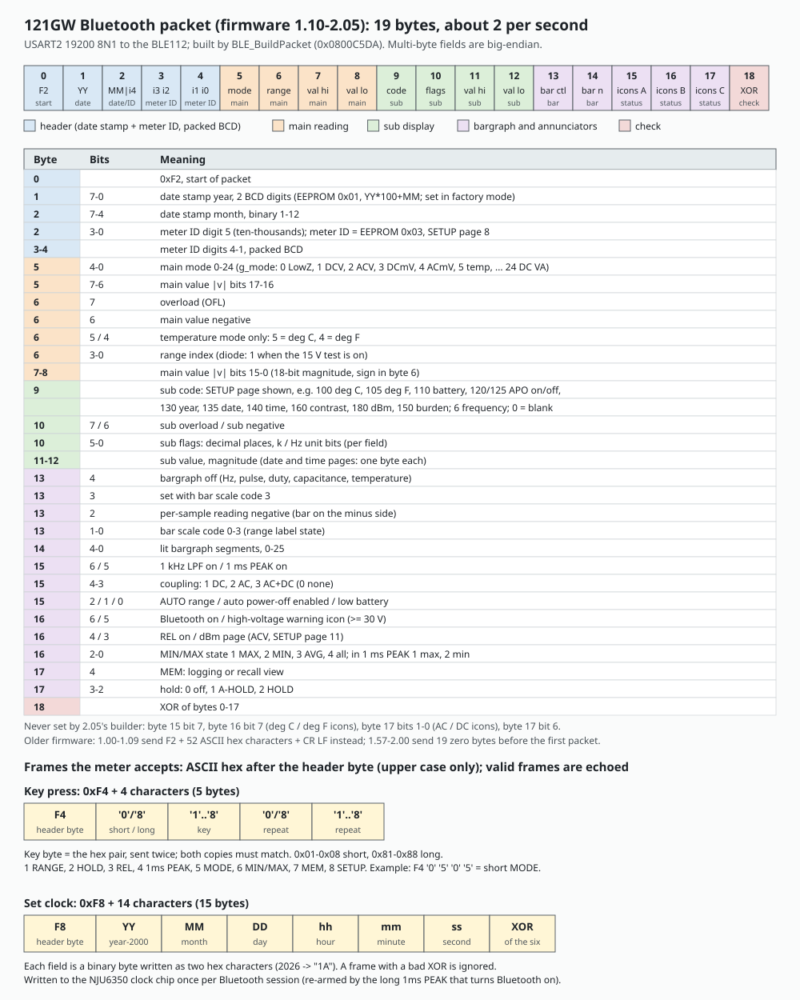

# Bluetooth in firmware 2.05

The 121GW's Bluetooth link: the BLE112 module and its UART, the 19-byte status packet the meter sends, the two remote commands it accepts (key presses and setting the clock), the rates, the known defects, and the telemetry extension we added to read the meter's EEPROM, bootloader and live HY3131 registers over the same link.

Main findings:

- Bluetooth is off at power-on and starts only on a long PEAK press. The MCU talks to a BLE112 module over USART2 at 19200 baud; the module carries the GATT side, and the meter's data arrives as notifications on one characteristic.
- About 0.3 % of the bytes the meter sends reach the PC damaged, stock firmware included; the likely cause is the weakly pulled-up meter-to-module line ([section 6](#6-link-errors-measured)).
- The meter sends one 19-byte packet (start byte 0xF2, XOR checksum) every 500 ms, about 2 per second. It mirrors the LCD: main value, sub display, bargraph and icons, plus the date stamp and meter ID.
- It accepts two frames: 0xF4 (a key press, short or long, for any of the 8 keys) and 0xF8 (set the clock, once per Bluetooth session). Both are ASCII hex and are echoed back.
- Our telemetry extension sends 0xD9 frames in the gap between stock packets without changing them. It is decoded by [../tools/tele_decode.py](../tools/tele_decode.py) and was how we read the HY3131 power-on state from a production meter.

How each claim was established: **[code]** read in the decompile ([../decompile/d205-g122.c](../decompile/d205-g122.c)), **[emulated]** run in our emulator with a USART2/BLE model (RX injection, TX capture), **[meter]** captured from a production meter over Bluetooth with [../tools/ble_capture.py](../tools/ble_capture.py).

Related: [../hardware/board.md](../hardware/board.md) (module power and pins), [architecture.md](architecture.md) (where the packet is built in the main loop), [../hardware/hy3131.md](../hardware/hy3131.md) (the diagnostic result).

## 1. The link

- **Module:** Bluegiga BLE112, powered from PF15, on USART2 (PD5 TX, PD6 RX, AF7), 19200 baud 8N1 **[code]**.
- **Start and stop:** `BLE_Toggle` is called only from the long-PEAK handler. `BLE_Start` (0x0801c390) raises PF15, configures the pins, initializes USART2 (the divisor is computed from the running clock, so 19200 holds at any SYSCLK), enables the receive interrupt and NVIC IRQ 38. `BLE_Stop` drops PF15 and disables the UART. Auto power-off and power-off stop it too **[code]**.
- **GATT [meter]:** the meter advertises as "121GW" (some modules show "Bluegiga"), connects without pairing, and sends its bytes as notifications on characteristic `e7add780-b042-4876-aae1-112855353cc1`. A packet can arrive split across notifications or several in one, so receivers must reassemble by start byte and checksum.
- **Transmit [code]:** TIM2's 50-tick cycle (500 ms) sets a flag at tick 40; the main loop then builds the packet (`BLE_BuildPacket` 0x0800c5da). At tick 50 the TIM2 handler sends byte 0 with a blocking write and enables the TXE interrupt, which sends bytes 1-18 one per interrupt. At 19200 baud a packet takes about 10 ms.
- **Rate:** about 2 packets per second; a production meter sent 91 packets in 45 s **[meter]**. Firmware 1.00-1.10 sent about 4 per second, and versions before 1.10 sent a 52-character hex text instead of binary **[emulated across the official releases]**.

## 2. The 19-byte status packet

Field meanings from `BLE_BuildPacket` and its helpers **[code]**, cross-checked against the decoder in the 121gw-qt front end, which descends from EEVblog's official app. In emulation, a DCV reading of 20000 counts appears as 0x4E20 in bytes 7-8 and every packet's checksum is valid **[emulated]**.

| Byte | Content |
|---|---|
| 0 | 0xF2 start byte |
| 1 | date stamp year, packed BCD (date stamp 1708 -> 0x17) |
| 2 | high nibble: date stamp month (binary 1-12); low nibble: meter ID digit 1 (ten-thousands) |
| 3-4 | meter ID digits 2-5, one per nibble |
| 5 | bits 0-4: mode (`g_mode`, table in [architecture.md](architecture.md) section 4); bit 6: value bit 16; bit 7: value bit 17 |
| 6 | low nibble: range (diode with the 15 V option reports 1); 0x10 deg F, 0x20 deg C (temperature only); 0x40 negative; 0x80 overload |
| 7-8 | main value magnitude, bits 15-0, big-endian (18 bits in all with byte 5) |
| 9 | sub display code (below) |
| 10 | sub flags: low bits = decimal places; 0x40 negative; 0x80 overload or open; 0x20 k, 0x10 Hz in the frequency fields |
| 11-12 | sub value, 16-bit big-endian |
| 13 | bargraph: bits 0-1 scale; 0x04 negative (per-sample reading below 0); 0x08 the 0-150 scale; **0x10 = bar off** (Hz, pulse, duty, capacitance, temperature) |
| 14 | bargraph segments lit (0-25) |
| 15 | status 1: 0x40 1 kHz filter; 0x20 1 ms PEAK; 0x10 AC, 0x08 DC, 0x18 AC+DC; 0x04 auto range; 0x02 APO on; 0x01 low battery |
| 16 | status 2: 0x40 Bluetooth on; 0x20 high-voltage warning (30 V and up); 0x10 REL; 0x08 dBm page (ACV, page 11); bits 0-2 MIN/MAX state (1 MAX, 2 MIN, 3 AVG, 4 all three; in 1 ms PEAK 1 = max, 2 = min) |
| 17 | status 3: bits 2-3 HOLD state (`Hold_State() x 4`); 0x10 logging or recall view |
| 18 | XOR of bytes 0-17 |

Notes **[code]**:

- Bits that decoders define but 2.05 never sets: byte 15 bit 7, byte 16 bit 7 (degree icons), byte 17 bits 0-1 and 6.
- Byte 1 is BCD while byte 2's month is binary. A decoder that reads byte 1 as a binary year offset gets 2023 for the default date stamp 1708. The date stamp is the manufacturing YYMM in EEPROM 0x01, not today's date; the meter ID is EEPROM 0x03, set on SETUP page 8 (0 unless someone set it).
- The main value is the reading as displayed, without the decimal point; the range gives its scale.
- **Sub display codes by SETUP page:** page 0 temperature 0x69 (deg F) or 0x64 (deg C), value in tenths; page 1 battery 0x6E (decivolts); page 2 APO 0x78 (on) or 0x7D (off); page 4 contrast 0xA0 (setting - 10); page 5 year 0x82; page 6 date 0x87 (month, day in bytes 11, 12); page 7 time 0x8C (hour, minute); page 10 by mode: ACV/ACmV frequency, continuity 0xAA + beep mode, diode 0x0B with value 3 or 15, VA the V or I half, current the burden flag; page 11 by mode (dBm in ACV, burden in VA); page 12 the burden value. Pages 3, 8 and 9 send a blank field.
- Each packet build also appends the main value to a 1000-entry RAM ring (0x20003950); nothing else reads it.

## 3. Remote commands

The receive interrupt collects a frame by its first byte: **0xF4 = 5 bytes, 0xF8 = 15 bytes**; anything else is dropped. The main loop then parses it (`BLE_ProcessRx` 0x0800c332). Payload bytes are ASCII hex pairs, **upper case only** (`BLE_HexPairToByte`: lower case counts as 0). A valid frame is echoed back unchanged (`BLE_SendReply`) **[code, emulated]**.

### 0xF4: key press
`F4 K K` where K is the key code as two ASCII hex digits, sent twice; the two copies must match. Example: `F4 30 32 30 32` = "0202" = short HOLD. The key is queued and handled at the next 10 ms tick (`Key_FromBLE`), including during the boot screen.

| Code | Key | Code | Key |
|---|---|---|---|
| 01 | RANGE | 05 | MODE |
| 02 | HOLD | 06 | MIN/MAX |
| 03 | REL | 07 | MEM |
| 04 | PEAK | 08 | SETUP |

Add 0x80 for a long press (81-88). A remote long PEAK (84) turns Bluetooth off, as the key does.

### 0xF8: set the clock
`F8` followed by 14 ASCII hex digits: year (2000 + n), month, day, hour, minute, second as binary bytes, then the XOR of those six bytes. Example: 2026-11-03 14:05:00 is `1A0B030E0500` + XOR. On a good checksum the frame is echoed and the values are written to the clock chip (converted to BCD) **once per Bluetooth session**: a latch blocks further F8 frames until Bluetooth is toggled off and on. A bad checksum is ignored **[code]**.

That is the whole command set: no direct mode or range selection, no settings, no log download.

## 4. Known defects

From our reading and from zombu4's list (their IDs), confirmed in emulation **[emulated]**:

- **OF-45:** the TIM2 handler's blocking first-byte send waits on TXE with no timeout; if USART2 is not clocked the meter hangs.
- **OF-10:** a status packet can be sent in the middle of a reply echo, interleaving the two.
- **OF-11:** turning Bluetooth on after the tick-40 build sends a stale packet first.
- **OF-34:** while the main display is blank (settling after a range change), packets carry a reading of 0.
- The counter-overflow path can store an uninitialized value as the reading; the display hides it behind OL, but a packet or log row taken then can carry it **[code]**.

## 5. Our telemetry extension

Stock packets show what the LCD shows. To read what the meter does not display, we added a telemetry path to stock 2.05 (the "v2" image: [../patches/telemetry.s](../patches/telemetry.s), built by [../patches/build_v2.py](../patches/build_v2.py), with four fixes: `zero-trim`, `big-card`, `temp-round`, `fattime`).

**How it is hooked [code of the patch].** The main loop's `bl HY_Poll` (0x08024B6A) calls `tele_poll` instead, which calls `HY_Poll` and, while Bluetooth is on and no frame is going out, sends one 19-byte frame every two TIM2 ticks in ticks 2-34 of the 50-tick cycle, the window in which the stock path is idle (it builds at tick 40 and sends at tick 50). Frames go out exactly the way TIM2 sends a stock packet. Stock packets are never modified. The boot screen's `bl HY_SetMode` (0x0800EA8A) calls the silent HY3131 diagnostic first (power-on register read and reserved-bit latch test, no screens, boot keys intact; [../hardware/hy3131.md](../hardware/hy3131.md) section 6).

**Frame:** `D9 kind off_hi off_lo d0..d13 xor`, the same length and checksum as a stock packet.

| Kind | Content |
|---|---|
| `E` | data EEPROM 0x08080000 + offset (12 KB dump) |
| `F` | flash 0x08000000 + offset (the 24 KB bootloader) |
| `O` | 0x1FF80000 + offset (option/ID/factory page, 256 bytes) |
| `R` | HY3131 R00-R33 as last read (offsets 0, 14, 28, 42) |
| `S` | mode, range, battery (decivolts, u16 LE), AD1 average (s32 LE), reading (s32 LE), GPIOG.IDR (dial and keys, u16 LE) |
| `T` | clock (6 bytes), jack-sense bits, PF8 strap, both variant flags, per-sample reading (s32 LE) |
| `A` | R34-R37 after configuration, latch mask, nonzero count, power-on R20-R27 |
| `B` | power-on R28-R35 |

**Schedule per sent frame (slot n):** n mod 8 = 0 an `R` frame (rotating offset); n mod 8 = 4 `S` and `T` alternately; n mod 16 = 2 `A` and `B` alternately; otherwise the next 14 bytes of the E, F, O dumps in turn, repeating.

**Results.** In emulation (150 s with Bluetooth on): no bad checksums, the stock packets all present, the EEPROM, bootloader and option-page dumps complete and byte-exact, live frames correct, boot keys and the SD calibration file unaffected **[emulated]**. The design rate is about 36 telemetry frames per second, but on a meter the BLE112 link carried only about 190 bytes per second in total (about 10 frames per second) **[meter]**, so many telemetry frames, and possibly stock packets, are dropped; `tele_decode.py` fills the gaps from later passes of the repeating dumps. The next version throttles telemetry to the measured throughput.

**Tools:**

    tools/ble_capture.py LOG.txt [--seconds N] [--address AA:BB:...]   # BlueZ D-Bus capture, no root, no pairing
    tools/tele_decode.py LOG.txt OUTDIR                                  # reassemble dumps, print the latest live frames
    tools/tele_timeline.py LOG.txt                                       # mode/range/HY3131 configuration over time

`ble_capture.py` connects, subscribes to the data characteristic, logs every notification as hex with a timestamp, checks the XOR of 0xF2 and 0xD9 frames, and stops on Ctrl-C or when `LOG.txt.stop` appears. `tele_decode.py` also reads the emulator's `--ble-all` output. Captured dumps contain the meter's calibration and settings; treat them as private to that meter.

## 6. Link errors (measured)

Measured on a production meter, 2026-11-03/04, with the custom firmware unless noted.

- **Bytes from the meter arrive damaged, at about 0.3 %.** Saved 1 KB YMODEM blocks arrived complete, with the meter's correct CRC, but 3 to 8 bytes per block had wrong values, different ones on every resend; no byte was dropped, added or shifted, and the changes are bit-level (0x02 to 0x80, 0x22 to 0x02) **[meter]**.
- **Stock firmware shows it too:** 3 of 91 status packets failed their XOR check on stock 2.05, 10 of 174 on the custom firmware; the rate climbs with the data rate (a fast diagnostic stream lost most of its frames) **[meter]**.
- **Not a clock problem:** the MSI clock, measured against the 4 MHz crystal with TIM11 (custom firmware), is within about 0.4 % of nominal, so the 19200-baud divisor is off by only about 0.15 % **[meter]**.
- **Not a matter of speed alone:** with 128-byte blocks, 20-byte bursts (one BLE packet) every 100 ms damaged about a quarter of the blocks, the same as 4-byte bursts at a fifth of the rate; 16-byte bursts, the earlier default, damaged about half **[meter]**.
- **The PC-to-meter direction is clean:** a 98 KB upload in 1 KB blocks arrived intact **[meter]**.
- **Likely cause, in the circuit:** the meter-to-module line (`BT_TX`, PD5) reaches the BLE112's RX through diode D4 and is pulled high only by R76, 10 kΩ, while the module-to-meter line is driven through R71, 100 Ω **[schematic]**. A weakly pulled-up line picks up noise; not yet confirmed by measurement.
- **What works:** 128-byte YMODEM blocks, 20-byte bursts, CRC-16 and up to 10 retries per block. A 146,484-byte file arrived byte-identical in 29 minutes (about 84 B/s; 532 blocks resent) **[meter]**. A 1,029-byte block arrives intact only about 1 time in 20, so 1 KB blocks are for uploads only.
