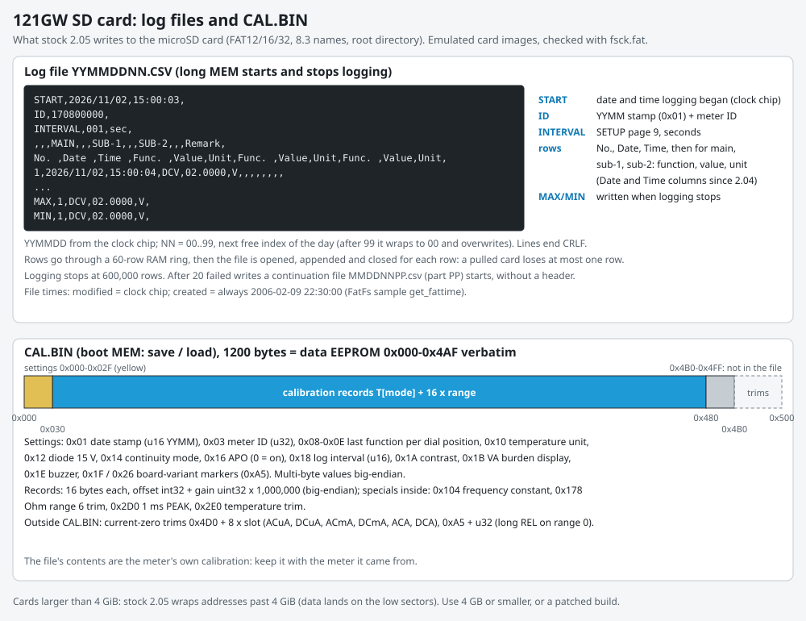

# SD card storage in firmware 2.05

The SD card driver and file system of stock firmware 2.05, the log file format and the 60-row RAM buffer behind it, the CAL.BIN backup file, file timestamps, the 4 GiB address wrap and what it takes to use cards up to 2 TB, and the state of exFAT support.

Main findings:

- The driver is ST's StdPeriph `sdio_sd.c` on a **1-bit bus** (only D0 is wired) with **no card detect**, run from the 4 MHz crystal. It uses only commands from the SD Association's free Simplified specification.
- The file system is **FatFs R0.08a** exactly, verified against ChaN's release archives: FAT12/16/32, 8.3 names, no exFAT.
- Logging collects rows in a **60-row RAM ring** and writes them to the card when the ring is full. Turning the dial to OFF cuts the battery, so up to 59 rows and the MAX/MIN footer are lost.
- Every file's creation time is FatFs's sample constant **2006-02-09 22:30:00**; only the modified time comes from the clock chip.
- **Addresses wrap at 4 GiB:** the disk layer builds the byte address in 32 bits, so on larger cards reads and writes past 4 GiB land on the low sectors, overwriting the MBR, FAT or other files. A 4-byte fix (`big-card`) lets a FAT32-formatted **2 TB** card work in emulation.
- exFAT (how cards over 32 GB ship) needs a newer FatFs. Our custom firmware (C-2.06) uses FatFs R0.16 with exFAT for the application **[meter, emulated]**; the SD bootloader stays R0.08a (FAT only, 4 GiB wrap), so firmware updates still need a FAT32 card.

How each claim was established: **[code]** read in the decompile ([../decompile/d205-g122.c](../decompile/d205-g122.c)), **[emulated]** run in our emulator with an SDIO + DMA + card model ([../tools/sdcard_model.py](../tools/sdcard_model.py)) on FAT images, checked afterward with fsck.fat and mtools, **[meter]** seen on a card written by a production meter.

Related: [calibration.md](calibration.md) (what CAL.BIN contains), [architecture.md](architecture.md) (where logging sits in the main loop), [../hardware/board.md](../hardware/board.md) (the slot's wiring).



## 1. Hardware and driver

- **1-bit bus, forced by the board [schematic, code]:** only SD_CLK (PC12), SD_CMD (PD2) and SD_D0 (PC8) are wired; PC11, the D3 pin, is the front end's CTL_B. The firmware still reads the SCR (ACMD51) and then sends ACMD6 with argument 0 (1-bit) even when the card offers 4-bit: correct for this board.
- **No card-detect switch:** `SD_Detect` (0x080226d6) always reports "present". A missing card shows up only as command timeouts.
- **HSE during SD access:** `CalFile_Save`, `CalFile_Load` and the log writer switch SYSCLK to the 4 MHz crystal before touching the card and back to MSI 4.194 MHz after.
- Data moves by **DMA2 channel 4** (SDIO FIFO <-> RAM in 32-bit words), completion through the SDIO (vector 45) and DMA2 channel 4 (vector 53) interrupts.

**Commands used [code]**, all in the Simplified Physical Layer Specification (nothing members-only: no CPRM, UHS-I or SDIO):

| Phase | Commands |
|---|---|
| Identify and initialize | CMD0, CMD8 (0x1AA: SD 2.0 / SDHC-capable host), CMD55 + ACMD41 (HCS), CMD2 (CID), CMD3 (RCA), CMD9 (CSD), CMD7 (select) |
| Bus | CMD16 (8) + CMD55 + ACMD51 (SCR, FIFO polling), CMD55 + ACMD6 (bus width, always 1-bit) |
| Read | CMD16 (512) + CMD17, single block only |
| Write | CMD16 + CMD55 + ACMD23 (pre-erase count) + CMD25 (multi-block) + CMD12 |
| Status | CMD13 |

Not used: CMD6 SWITCH (no high speed: default speed, 25 MHz at most), CMD18, erase, CMD10, ACMD13, CMD42. The full identification runs again for every file operation (each one mounts afresh), twice per calibration save.

**Error handling [code].** `SD_InitMount` (0x0801f8ba) drops `SD_Init`'s result and returns only `f_mount`'s, which is always OK because R0.08a mounts lazily; its 0x300-try retry loop therefore runs once, and a card that fails to initialize shows up later as a FatFs error ("-Err-" or "SdE.03" in emulation). `disk_read` reads one sector whatever the count (every caller asks for one, so it does not bite today; zombu4 OF-42); `disk_write` sends one CMD25 per sector, ignores the driver's return values and reports a timeout as write-protected.

## 2. FatFs R0.08a

**Version, and how we verified it [code, against ChaN's archives ff8.zip ... ff9b.zip]:**

- lower bound: `create_name`'s illegal-character table (0x08029164) is `"*+,:;<=>?[]|` plus 0x7F; R0.08 lacks the `;` (the R0.08a change log: "Fixed a wrong directory entry is created on non-LFN cfg when the given name contains ';'");
- upper bound: `create_name` starts directly at path[0] (disassembly at 0x08021426); R0.08b added a loop there that skips duplicated separators;
- consistent with both: `validate(fs, id)` with two arguments (R0.09a changed it), the FATFS window at offset 48 (R0.09b moved it), FATFS 560 / FIL 548 bytes, `f_mount(vol, fs)`, `chk_mounted` reading FSInfo directly.

EEVblog's reconstruction arrived at R0.08a independently by byte-matching. Our first reading had said R0.09-R0.09b; that was wrong. Configuration: no long file names (8.3 only), code page 932 (the default `ffconf.h`), no file locking, no fast seek, `f_mkfs` and `f_getfree` not linked. `chk_mounted` checks a volume at sector 0, then MBR partition 1 only.

**Would a newer FatFs help?** The firmware uses mount, open, read, write, lseek, sync, close, opendir, readdir, stat and utime, and never deletes, renames, formats or makes directories. The fixes since R0.08a that apply are R0.10b ("a hard error in the disk I/O layer can collapse the directory entry") and R0.10c (FAT access on disk error), both relevant because `disk_write` ignores errors, and R0.10's corrected `f_open` error codes. The visible SD problems are all in 2.05's own glue (the 4 GiB wrap, the constant creation date, ignored init and write errors), not in FatFs. A FatFs swap is not a binary patch (structure layouts and inlined offsets change); it needs a rebuild from source.

## 3. Logging

**Long MEM** toggles logging (`Log_Toggle` 0x0801657c). Starting clears HOLD, REL and MIN/MAX and locks the range. The interval is SETUP page 9 (EEPROM 0x18, seconds, 0-999); interval 0 logs as fast as the TIM2 schedule allows, at most 5 rows per second **[code]**.

**The 60-row RAM ring [code; meter].** `Log_StoreSample` puts each row into a 60-entry ring in RAM; when it is full, the main loop writes it to the card (`Log_WriteRetry` -> `Log_Write` 0x0801d1a8: mount, open/append, write, close). Each write is read back and compared (`Log_VerifyWrite`); on a mismatch the row counter is rewound. Up to 20 tries, then an SD re-init and 20 more; after that the file is continued as `MMDDNNPP.CSV` (part counter PP) without a header. MAX/MIN rows are written when logging stops. Because the dial's OFF position cuts the battery, everything still in the ring is lost at power-off: a production meter's DCV log ended at **exactly 60 rows with no MAX/MIN footer** and a 2006 modified time (the footer and the final timestamp write never ran) **[meter]**.

Rows store the per-sample reading `g_reading_fast`, not the filtered value on the display (zombu4 OF-35). Records in the recall view come from the same ring; with more than 60 rows logged, entering the view may not start at the newest record **[code]**.

**File name and format [emulated].** `YYMMDDNN.CSV` (date from the clock chip; NN = today's highest index + 1, wrapping from 99 to 00 and overwriting the day's first file), CRLF lines:

```
START,2026/11/02,15:00:03,
ID,170800000,
INTERVAL,001,sec,
,,,MAIN,,,SUB-1,,,SUB-2,,,Remark,
No. ,Date      ,Time    ,Func. ,Value,Unit,Func. ,Value,Unit,Func. ,Value,Unit,
1,2026/11/02,15:00:04,DCV,02.0000,V,,,,,,,,
...
MAX,1,DCV,02.0000,V,
MIN,1,DCV,02.0000,V,
```

`ID` = the EEPROM date stamp (0x01, YYMM; default 1708) followed by the five-digit meter ID (0x03); a meter whose ID was never set shows 170800000.

**Limits [code]:** logging stops after 600,000 rows (about 30 MB, far below FAT32's 4 GB file limit). A low battery stops logging with code 100, shown as "SdE" plus two blanks (the error counter shows only 0-19 correctly). After the first row an OL sample never becomes MAX, but a negative OL sample still competes for MIN by its raw value.

## 4. CAL.BIN

Boot MEM, then REL (save) or PEAK (load), then MODE. The file is `CAL.BIN` in the root, **1200 bytes = data EEPROM 0x000-0x4AF**: settings, variant markers and calibration records, but not the current-zero trims at 0x4D0-0x4FF. Load restores all 1200 bytes (another meter's file brings its markers along) and shows "SAvEd" on success, the same message as a save. Details, and a fix that extends the file to 1280 bytes: [calibration.md](calibration.md) section 4.

## 5. Timestamps

- **Creation time is always 2006-02-09 22:30:00 [code, emulated]:** `get_fattime` (0x0802402e) returns FatFs's sample constant. `File_SetTimestamp` (0x0801d37c) then rewrites the modified time from the clock chip when a file is closed normally, so a PC shows the right modified date and a 2006 created date. The SD bootloader has the same constant.
- Our fix `fattime` replaces the constant with the clock chip's time **[emulated: creation times correct, log content identical]**. Neither EEVblog's reconstruction (faithful on purpose) nor zombu4's firmware changes it.

## 6. Cards over 4 GiB: the address wrap

**[code, emulated]** `disk_read` (0x08023f7e) and `disk_write` (0x08023fb8) pass the driver a 64-bit byte address built as `sector << 9` in 32 bits with the high word fixed at 0 (`lsls r2, r5, #9; movs r3, #0`), so the meter reaches only `sector mod 2^23`.

- Emulated on an 8 GiB card whose only partition starts at LBA 8,390,656 (just past 4 GiB): the meter read block 0 (MBR), then block 2048 (8,390,656 mod 2^23) instead of the boot sector, found no file system and showed "-Err-".
- On a real card larger than 4 GiB, any access past the 4 GiB mark lands on the low sectors (MBR, FAT, the first files). With stock 2.05, **use a card of 4 GB or less**, or keep the partition and all data below 4 GiB. A common SDHC card whose data all sits in the first few megabytes works until the card fills past 4 GiB **[inferred]**.
- **Fix `big-card`:** two 2-byte changes put `sector >> 23` in the high word (`lsrs r3, r5, #23`). Emulated: the calibration save on the 8 GiB card works and every access goes to the right block; a small card's trace is identical to stock. Neither public alternative firmware fixes this.

## 7. 2 TB cards

**Target:** cards up to 2 TB on FAT32. A 2 TB SDXC card has about 4.0 billion 512-byte sectors, below 2^32, so 32-bit sector numbers (R0.08a, or a newer FatFs without 64-bit LBA) reach all of it.

- **Driver: fine [code].** SDXC answers ACMD41 with CCS = 1 like SDHC (block addressing). The only capacity the driver computes (`SD_GetCardInfo`, (C_SIZE + 1) x 512 KiB in 32 bits) overflows above 4 GB, but nothing reads it; `disk_ioctl`'s fixed sector count is used only by `f_mkfs`, which 2.05 does not link.
- **Addressing:** `big-card` is all the driver path needs.
- **File system:** R0.08a reads FAT32 only. A 2 TB card formatted FAT32 with 32 KB clusters (about 62.5 million clusters, two 244 MB FATs) is within its limits. Linux formats it directly (`mkfs.fat -F 32 -s 64`); Windows' own tools refuse FAT32 above 32 GB.
- **Emulated [emulated]:** a sparse image with a real 2 TB card's exact size and partition start (sector 131,072), FAT32, with the FSInfo next-free hint 200 clusters from the end so new data lands near 2 TB. V, long MEM, 30 s. With `big-card`, the log data went to LBA 3,999,747,520 (2.048 TB), fsck.fat was clean and the CSV read back with its header. **Stock 2.05** produced a file with the right size and directory entry but holding zeros: its data went to LBA 6,770,112 (about 3.2 GiB in), the wrapped address. fsck.fat passes such a card because it cannot see file contents, so on a used card stock 2.05 silently overwrites another file.
- **Still open:** a first write with an invalid or stale FSInfo hint on a nearly full card makes FatFs scan the FAT linearly (up to 488 MB of single-block reads); not measured.

## 8. exFAT

Cards over 32 GB ship formatted exFAT, which R0.08a cannot read; with 2.05 (stock or patched) they must be reformatted FAT32. exFAT arrived in FatFs R0.12 and needs long-file-name support plus more RAM and flash. Moving to R0.16 as a binary patch would need a wrapper layer between 2.05's code and the new library; that was not completed. The project now builds custom firmware from EEVblog's C reconstruction instead, where exFAT becomes a library upgrade. **Status: not implemented.**

## 9. Emulator notes

- The card model answers each command at once and raises the SDIO/DMA interrupts inside the same 1 ms slice, so SD timing is not modeled; the data and the protocol are.
- Large cards are sparse image files; [../tools/sparse_extract.py](../tools/sparse_extract.py) extracts the partition (`sparse_extract.py CARD.img PART.img 131072`) for `fsck.fat -n` and mtools. [../tools/make_sd_images.zsh](../tools/make_sd_images.zsh) builds the test images.
- Building the model exposed an emulator bug: FLASH.SR flags are write-1-to-clear, and keeping the clear write made every data-EEPROM write fail in emulation until it was fixed.
