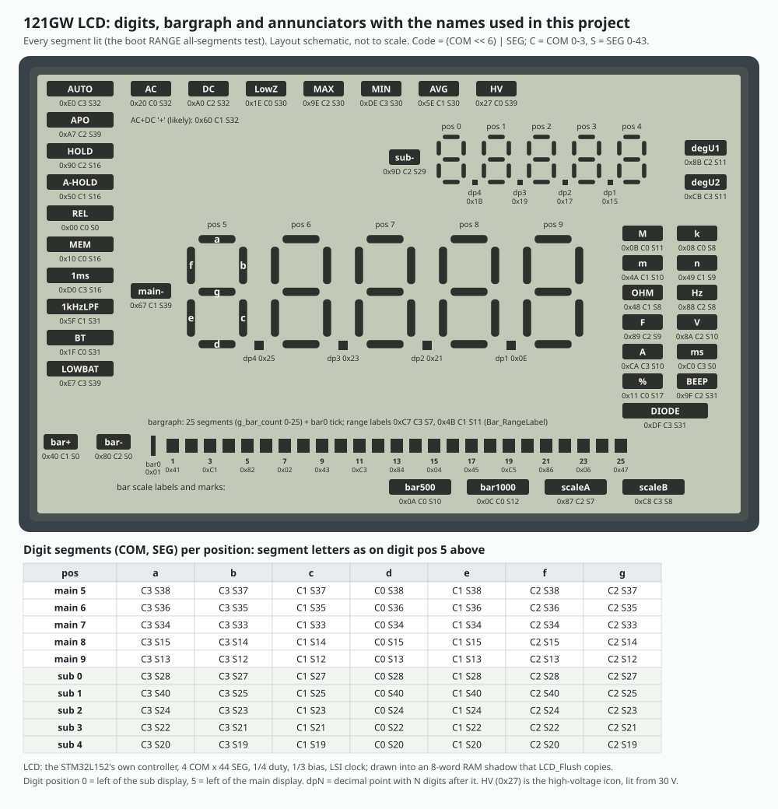

# The 121GW board as firmware 2.05 reveals it

Everything on the board except the HY3131 measurement chip ([hy3131.md](hy3131.md)): the STM32L152 microcontroller, its clocks, power rails and pins, the LCD, the Bluetooth module, the SD card slot, the clock chip, the buzzer, the battery and thermistor inputs, and the straps and EEPROM bytes that tell board variants apart. Most of it is read from what the firmware does to each pin, checked against EEVblog's circuit diagram.

Main findings:

- The MCU runs from its internal MSI oscillator at 4.194304 MHz. The 4 MHz crystal (X2) is used only while the SD card is accessed, and there is no 32 kHz crystal on the MCU: the LCD runs from the internal LSI, and timekeeping is an external NJU6350 clock chip.
- The dial's OFF position cuts the battery in hardware. Auto power-off is a firmware STOP mode with every pin analog.
- The SD slot is wired 1-bit (D0 only) and has no card-detect switch.
- The Bluetooth module (BLE112) is unpowered until the user turns Bluetooth on; it is a UART bridge at 19200 baud.
- One pin strap (PF8) and two EEPROM bytes (0x1F, 0x26) select board variants. A production meter carries 0x1F = 0xA5 and 0x26 = 0x00.
- 2.05 writes the option bytes once to turn brown-out reset off, so every meter that has run it has BOR off.

How each claim was established: **[code]** read in the 2.05 decompile ([../decompile/d205-g122.c](../decompile/d205-g122.c)), **[emulated]** observed when stock 2.05 runs in our emulator, **[schematic]** EEVblog's circuit diagram, **[meter]** on a production meter, **[inferred]** fits the evidence but is stated nowhere. Function names and addresses are the ones in the decompile.

Related: [../firmware/architecture.md](../firmware/architecture.md) (startup order and the main loop), [../firmware/storage.md](../firmware/storage.md) (SD card), [../firmware/bluetooth.md](../firmware/bluetooth.md) (BLE link).

## 1. Microcontroller and memory

| Item | Value |
|---|---|
| MCU | STM32L152ZD (Cortex-M3, ST device ID 0x436) |
| Flash | 384 KB: SD bootloader 0x08000000-0x08005FFF (24 KB, not part of firmware updates), application from 0x08006000 |
| RAM | 48 KB at 0x20000000 |
| Data EEPROM | 12 KB at 0x08080000: settings, calibration, current-zero trims ([../firmware/calibration.md](../firmware/calibration.md)) |
| Option bytes | RDP level 0, no write protection; BOR off after 2.05 has run once |

**Brown-out reset is turned off by the firmware [code].** `Board_Init` checks the BOR level in the option bytes; if it is not 0, it writes 0 and relaunches the option bytes, which resets the MCU, and the next boot continues. The SD bootloader does the same. The firmware does its own low-battery handling instead (section 8).

**Debug in low power [code]:** `DBGMCU_Config(SLEEP | STOP | STANDBY)`, so SWD keeps working while the meter sleeps.

## 2. Clocks

| Source | Use | Evidence |
|---|---|---|
| MSI range 6, 4.194304 MHz | SYSCLK for everything except SD access | `Board_ClockSelect(0)` **[code, emulated]** |
| HSE, X2 4 MHz crystal | SYSCLK only during SD card access (`Board_ClockSelect(1)` before, `(0)` after) | **[code]** |
| PLL (HSE x12 / 3 = 16 MHz) | set by `SystemInit` and immediately undone | **[code]** |
| LSI | RTC block and LCD controller clock | `Board_RTCClockInit` **[code]** |
| LSE | off; the 32 kHz crystal position on the MCU is not fitted | **[code]** |
| X1 4.9152 MHz | the HY3131's own clock | **[schematic]** |
| X4 32.768 kHz | the NJU6350 clock chip | **[schematic]** |

Consequences: TIM2 (10.02 ms) and TIM3 (0.996 ms) use fixed prescalers and periods, so their timing, and every software delay loop (the HY3131 and clock-chip bit-banging), is right only at 4.194304 MHz. The BLE UART is not affected: `USART_Init` computes its divisor from the running clock. Several waits have no timeout (HSI, LSI, VOSF, ADC ready, LCD ENS/RDY) and `Board_ClockSelect(0)` deliberately loops forever if HSE will not stop: any of them is a silent hang at power-on **[code]**.

## 3. Power

**[code + schematic]**

- The battery reaches B+ through the rotary switch (T1 contacts 17/18), so **dial OFF is a hardware power-off** the firmware never sees. A log being written at that moment loses its unwritten rows ([../firmware/storage.md](../firmware/storage.md)).
- On any function position, U2 NJU7200U33 (3.3 V, no enable) powers the MCU through D1.
- **PD1** (HW_PWR_CTL2) enables U13 NJU7741F04 (+4.0 V). **PE9** (HW_PWR_CTL) enables U1 NJM2870F-36, the 3.6 V analog VDD for the HY3131. `Board_GPIOInit` turns +4.0 V on first, then VDD; `Power_Off` reverses the order and drops PE9 last.
- **Auto power-off is STOP mode** (`App_Sleep`, reached only from the APO countdown): rails off, clocks down to MSI at about 65 kHz, HSI/HSE/LSE off, every pin analog, EXTI wake armed on the rotary lines except the current one. Turning the dial wakes the MCU and re-runs the board and application init and the boot screen. The APO icon blinks in the last 60 s, with five 500 ms beeps at the start of that minute.

## 4. Pin map

From `Board_GPIOInit`, the `Frontend_*` setters and the drivers **[code]**; net names from the CubeMX-style labels in the firmware's pin setup and the schematic.

| Pin(s) | Function | Notes |
|---|---|---|
| PG0-PG7 | rotary switch, one-hot, active low, pull-up | PG7 LowZ, PG6 V, PG5 mV, PG4 Hz, PG3 Ohm, PG2 VA, PG1 uA, PG0 mA/A **[emulated]**; debounced as 5 identical one-hot reads plus a 15-tick lockout |
| PG8-PG15 | keys, active low, pull-up | PG8 MODE, PG9 SETUP, PG10 MIN/MAX, PG11 MEM, PG12 RANGE, PG13 HOLD, PG14 REL, PG15 PEAK; key code = 1 << (pin - 8) |
| PE10, PE11 | jack sense: mA jack, A jack (low = lead present) | 10-tick debounce; the firmware swaps A and mA modes by itself and shows " LEAD" for a lead in a current jack off the current positions |
| PF0-PF3 | HY3131 CK, CS, DI, DO/IRQ | [hy3131.md](hy3131.md) section 2 |
| PF4, PF5, PD0, PC11, PH2, PA12, PE15, PF6, PE12, PE5, PD7, PA11 | analog front-end switches | per-mode table in [hy3131.md](hy3131.md) section 5.3 |
| PE9, PD1 | 3.6 V analog VDD enable, +4.0 V enable | section 3 |
| PE7 | buzzer | section 7 |
| PE8 | LCD backlight | |
| PA4 | thermistor (cold junction), analog | section 8 |
| PA5 | battery divider, analog | section 8 |
| PF11, PF13, PF14 | set analog | no other use found |
| PF8 | board-variant strap | section 9 |
| PB6, PB7, PC13 | NJU6350 clock chip: clock, data, CE | section 6 |
| PF15 | BLE112 power | section 5 |
| PD5, PD6 | USART2 TX, RX (AF7) to the BLE112 | section 5 |
| PC8, PC12, PD2 | SDIO D0, CK, CMD (AF12; pull-ups on D0 and CMD) | D1-D3 are not wired; PC11, the D3 pin, is CTL_B of the front end |
| PE13 | "SCH_UNCONNECTED_A" | only ever driven low: a spare pin, not a hidden function |
| LCD pins on GPIOA-E | segment and common lines (alternate function) | section 10 |

## 5. Bluetooth module (BLE112)

**[code]** A Bluegiga BLE112 module powered from **PF15** and connected to USART2 (PD5 TX, PD6 RX) at 19200 baud 8N1. `Board_GPIOInit` leaves PF15 low, and the only path to `BLE_Start` is a long PEAK press: Bluetooth never starts by itself. `BLE_Start` raises PF15, sets the UART pins, enables USART2 and its receive interrupt (IRQ 38); `BLE_Stop` drops PF15 and disables the UART. The module itself carries the GATT side; the MCU only sees a byte stream. Packets, commands and rates are in [../firmware/bluetooth.md](../firmware/bluetooth.md).

## 6. Clock chip (NJU6350)

**[code; emulated with a model of the chip]** A 3-wire bit-banged interface: **PC13** = CE (high selects), **PB6** = clock, **PB7** = data (switched to input for reads). Each access sends a 4-bit register address LSB first (address + 1 for a write), then 8 data bits LSB first, with `Delay_Loop(5)` between edges. Registers used: 2 year, 4 month, 6 day, 10 hour, 12 minute, 14 second, all BCD.

`Settings_LoadClock` reads all six once per second and falls back field by field when a value is out of range (year 2016, month 7, day 1, hour 12, minute 0, second 0). `RTC_PollSeconds` watches the seconds register every 10 ms to drive the 1 Hz blink phase and the once-a-second work. The clock is set from SETUP pages 5-7 or by a Bluetooth 0xF8 frame. A meter whose clock was never set reports the chip's power-up date; on one production meter that was 2016-09-19 **[meter]**.

## 7. Buzzer and backlight

**[code]** The buzzer on **PE7** is toggled by the TIM3 (1 ms) interrupt following a pattern: short beep 100 ms, long 200 ms, double beep (two 50 ms pulses) for "not available here". The SETUP "buzzer off" setting (EEPROM 0x1E) is honored only by key beeps; continuity, diode, the auto-hold capture beep, the high-voltage warning (500 ms every other half second from 600 V or OL on the 600 V range) and the APO warning sound regardless (`Buzzer_OnAlways`). The backlight is **PE8**.

## 8. Battery and thermistor (MCU ADC)

**[code; emulated with chosen ADC values]** The ADC is powered only for each conversion (`ADC_ReadOnce`, 384-cycle sample time).

- **Battery, PA5**, through R69 1M / R70 330k. `Battery_Update` maps the raw value through a 16-entry linear table (raw 0xC30..0x3FC -> 10.50..3.00 V), takes a 20-sample trimmed mean (drop the 5 highest and 5 lowest) and needs 10 consecutive readings before the low-battery icon changes. **Low battery = under 4.1 V.** SETUP page 1 shows it as "BAT6.0" (decivolts).
- **Which ADC reference the table assumes is open.** Its scale (3.57 mV per count) fits a 3.6 V reference (VREF+ on the switched analog VDD), not 3.3 V (3.25 mV per count) **[inferred]**. If the reference is in fact 3.3 V, the table reads low by several percent, which is how zombu4 describe their OF-52 (battery gauge linear fit). A measurement of B+ against the displayed value on a meter would settle it.
- **Thermistor, PA4** (the thermocouple cold junction): a raw value under 51 counts for 10 readings sets a thermistor fault (cold junction 0); otherwise a 10-sample moving mean converts to 0.01 deg C plus a trim captured in calibration mode (reference 23.00 C). Usable range -25 to 85 C; the cold-junction compensation holds its last value outside -20..100 C.

## 9. Board variants: the PF8 strap and the EEPROM markers

**[code; values on a production meter: meter]**

| Selector | How it is read | Effect |
|---|---|---|
| **PF8 strap** | `Board_ProbePF8` at boot: pull-up, 20 samples; low on 11 or more -> `g_pf8_strap_low`; the pin goes back to analog | capacitance HY3131 table (comparator thresholds), capacitance range 4 gain scale (/10,000 instead of /100,000), diode +500-count fix (PF8 low + 15 V option + reading above 14,000), VA correction tables for mode 15 ranges 2/3 |
| **EEPROM 0x26** | `!= 0xA5` -> `g_variant_ohm6 = 1` | 0xA5 closes HY3131 switch PS0 on Ohm range 6 (C30 27 nF across the 10M reference) and turns on software correction curves for Ohm ranges 5 and 6 (range 6 scaled by the trim at EEPROM 0x178); any other value: neither |
| **EEPROM 0x1F** | `!= 0xA5` -> `g_variant_acv0 = 1` | ACV range 0 frequency-response correction tables (two sets), plus an extra correction (`ACFreq_CorrectAcv0`) only when the marker is absent |

- Only the AC calibration path (`Cal_AcGainCapture`) writes 0xA5 to either marker, so they record what the factory calibration did rather than a fixed property of the PCB. The reading that suits the evidence is two board revisions with different resistor networks, told apart at calibration **[inferred]**.
- **A production meter carries 0x1F = 0xA5 and 0x26 = 0x00 [meter]:** it runs ACV range 0 without the extra correction, and Ohm ranges 5 and 6 without PS0 and without the software curves. Synthetic test images that set both markers do not match it.
- The markers are inside the CAL.BIN backup, so loading another meter's CAL.BIN imports that meter's markers ([../firmware/calibration.md](../firmware/calibration.md)).
- After an Ohm range 6 calibration the RAM flag and the EEPROM marker disagree until the next power-on (the calibration writes 0xA5 but sets the RAM flag to 1), so range 5/6 corrections differ before and after a reboot **[code]**.
- PF8 has no label in the firmware's CubeMX pin map. EEVblog's video project calls the strap-low variant "fdf".

## 10. LCD

**[code; segment map cross-checked on emulated screens]** The glass is driven by the STM32L152's on-chip LCD controller, not a separate chip.

- **Geometry:** 4 commons x 44 segments, 1/4 duty, 1/3 bias, clocked from LSI. `Board_LCDInit` sets prescaler, divider, dead time 0, pulse-on 0x40, contrast `(setting - 10) << 10`, enables the controller and **waits for ENS and RDY with no timeout**: without LSI the meter sits with a blank glass and looks dead.
- **Shadow RAM:** 8 words at 0x20007790 (COM0 SEG0-31, COM0 SEG32-43, COM1 ...), copied to LCD RAM by `LCD_Flush`, which then requests an update and waits for it (UDR).
- **Layout:** a 5-digit main display and a 5-digit sub display (digit positions 5-9 and 0-4 in `LCD_DrawChar`), decimal points, a 25-segment bargraph plus its zero, sign and scale marks, and icons (units, AC/DC, AUTO, HOLD, REL, MIN/MAX/AVG, MEM, BT, APO, LowZ, 1 kHz filter, 1 ms PEAK, low battery, high voltage). The high-voltage icon is COM0 SEG39. Segment codes are `(COM << 6) | SEG`; [../tools/lcd_decode.py](../tools/lcd_decode.py) decodes a shadow dump into text and icons.
- **Font:** ASCII to 7-segment at 0x0801affc; `LCD_DrawChar` clears only the 7 glyph bits, so decimal points survive. The firmware has no "H": "h" is drawn instead.
- **Contrast:** SETUP page 4, stored at EEPROM 0x1A, valid 12-17, default 14. At boot `LCD_SetContrast` ANDs the wanted level into the register instead of setting it, so an out-of-range value passes a stale register value through (zombu4 OF-50).
- **Auto-hold** switches the flush to `LCD_FlushBarOnly`: the digits stay frozen while the bargraph stays live.
- **All segments on:** hold RANGE at power-on.

## 11. SD card slot

**[schematic + code]** SDIO with only CLK, CMD and D0 wired (1-bit bus), DMA2 channel 4, completion by the SDIO and DMA2 channel 4 interrupts (the only interrupts at the highest priority). No card-detect switch: `SD_Detect` always reports "present", so a missing card shows up only as command timeouts. The MCU switches to the 4 MHz crystal for every SD access. Driver, file system and file formats: [../firmware/storage.md](../firmware/storage.md).

## 12. Other ICs named on the schematic

U8 MAX4238 (precision op-amp: current-shunt x10 amplifier), U9 and U16 HEF4053, U15 HEF4052, U11 74HC4053 (front-end analog switches the MCU drives), U10 RT9271 (boost converter, the 15 V diode-test supply **[inferred]**), U17 AD8436 (true-RMS converter), ZD1 ADR3412 (1.2 V reference), U14 not fitted. Their roles per mode are in [hy3131.md](hy3131.md) section 5.3.

## 13. Hazards for a rewrite

1. Interrupts may not be enabled before the vector table moves to 0x08006000 (VTOR points at the bootloader's table until `main` moves it).
2. Run at MSI 4.194304 MHz, or rescale TIM2, TIM3 and every delay loop.
3. Start LSI before the LCD; avoid the untimed waits or give them timeouts.
4. Turn +4.0 V on before the 3.6 V VDD; leave no front-end line floating; HY3131 CS high before any transfer.
5. Reach the same STOP state for auto power-off (rails off, pins analog), or APO drains the batteries with the dial on a function.
6. Keep a SysTick handler (or stop SysTick before enabling interrupts): 2.05 never uses SysTick, but its handler is harmless if something else left it running.
7. Turning BOR back on changes low-battery behavior from the firmware's own handling to a hardware reset.
8. Read the PF8 strap and both EEPROM markers; a single hard-coded table set gets another variant wrong.
