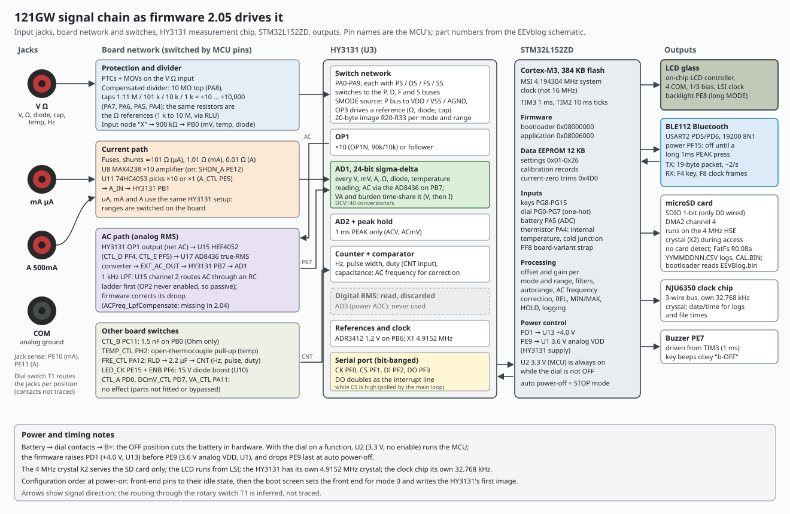

# HY3131: the measurement chip and how firmware 2.05 drives it

The 121GW measures through a HYCON HY3131 (U3), a 50,000-count DMM front end. This document covers the chip's serial bus and registers, how stock firmware 2.05 configures and services it, the complete switch network for every mode and range, the reserved and undocumented register bits, and what a diagnostic image found on a production meter.

Main findings:

- 2.05 talks to the chip over a bit-banged 4-wire bus whose data-out line doubles as the interrupt line. It writes only four register addresses (0x1B, 0x1E, 0x20, 0x29) and reads 0x00-0x33. It never touches R34-R37, so the chip's power-AD (AD3) is unused and the 0x60 soft reset is never sent.
- Every configuration is one 20-byte burst to R20-R33, taken from 15 tables in flash. We decoded every reachable image into switch closures and signal paths (section 5).
- True RMS comes from the external AD8436 (U17) measured by AD1, not from the HY3131's own RMS block, whose result is read and thrown away. The chip's RMS, low-pass and peak blocks run only in the 1 ms PEAK images.
- The Ohm range 6 variant controlled by EEPROM byte 0x26 closes switch **PS0** (R2A bit 3), which puts C30 (27 nF) across the 10 M reference resistor. An earlier reading said SS6; that was wrong.
- On a production meter, R34-R37 power on as 00 00 00 00, the only nonzero power-on register in R20-R33 is R33 = 0x20 (ENOSC), and all six reserved bits in R20-R33 are real latches, including the three the datasheet marks "-".

How each claim was established: **[datasheet]** stated by HYCON (DS-HY3131-V10_EN; section numbers below are its own), **[schematic]** read from EEVblog's 121GW circuit diagram (rev. 2018-01-15), **[code]** read in the 2.05 decompile ([../decompile/d205-g122.c](../decompile/d205-g122.c)), **[emulated]** seen on the pins when stock 2.05 runs in our emulator with the pin-level HY3131 model ([../tools/hy3131_model.py](../tools/hy3131_model.py)), **[meter]** measured on a production meter, **[inferred]** a reading that fits all the evidence but is stated nowhere.

Related: [board.md](board.md) (the rest of the board), [../firmware/architecture.md](../firmware/architecture.md) (what happens to a conversion after it is read), [../firmware/calibration.md](../firmware/calibration.md) (how the variant markers get written).

## 1. The chip

A DMM analog front end with **[datasheet]**:

- **AD1**, a 24-bit sigma-delta ADC (the measurement ADC in every mode except 1 ms PEAK);
- **AD2** and **AD3**, two fast 19-bit sigma-delta ADCs with a digital low-pass filter, a true-RMS calculator and a peak-hold block;
- a 24-bit frequency counter (CTA, CTB, CTC) with a comparator;
- a programmable switch network (pins PA0-PA9, PB0-PB8, RLU, RLD) and a voltage source for ranging;
- three op-amps (OP1, OP2, OP3), a temperature sensor and an SPI-like serial port.

On the 121GW it has its own 4.9152 MHz crystal (X1) and runs from the switched 3.6 V analog rail (U1 NJM2870F-36, enabled by MCU pin PE9) **[schematic]**.

## 2. The serial bus

| Line | MCU pin | Direction |
|---|---|---|
| CS | PF1 | MCU out; low = frame |
| CK | PF0 | MCU out; idles low; must be low before CS falls |
| DI | PF2 | MCU out; latched on the CK rising edge |
| DO | PF3 | chip out; **while CS is high, DO is the interrupt line** |

- Frame: CS low, then one byte `ADDRESS<6:0>` followed by R/W, MSB first (`addr << 1 | rw`) **[datasheet]**.
- Write (rw 0): data bytes follow; the address increments after each byte until CS rises.
- Read (rw 1): one blank clock, then data from ADDRESS, auto-incrementing.
- 2.05's driver **[code, emulated]**: `HY_Write` 0x0800c03c (DI high, CK low, CS low, delay, address byte, each data byte followed by a delay, CS high); `HY_Read` 0x0800c0c0 (address | 1, the blank clock, bytes into the RAM mirror at 0x200077d0); bit out 0x0800c16c (DI, then a CK pulse); bit in 0x0800c138 (CK high, sample PF3, CK low).
- The delays are bare busy loops (0x0800ecf6), so the bus timing scales with the CPU clock, which 2.05 runs at 4.194 MHz (MSI). A faster clock shortens the CK high and low times; check them against the datasheet's TCKLO/TCKHI before changing it.
- There is no separate interrupt pin: the main loop polls PF3 between frames **[code]**.

## 3. Registers

| Address | Name | Use **[datasheet]** |
|---|---|---|
| 0x00-0x02 | AD1 | 24-bit AD1 result, little-endian (read as lo, mid, hi) |
| 0x03-0x05 | AD2 | 19-bit AD2, sign-extended |
| 0x06-0x08 | LPF | low-pass filter output |
| 0x09-0x0D | RMS | 40-bit true-RMS accumulator |
| 0x0E-0x13 | PKHMIN, PKHMAX | peak hold |
| 0x14 | CTSTA | counter and comparator status (PCNTI, ACPO, CMPHO, CMPLO, ..., CTBOV) |
| 0x15-0x1D | CTC, CTB, CTA | counter: CTA = gate preset and time, CTB = input cycles, CTC = high time |
| 0x1E | INTF | BORF . . RMSF LPFF AD1F AD2F CTF; cleared when read, writable to 0 only |
| 0x1F | INTE | . . . RMSIE LPFIE AD1IE AD2IE CTIE; DO (with CS high) = (INTF & INTE) != 0 |
| 0x20-0x33 | R20-R33 | configuration: comparator and counter, AD1 setup, AD1/AD2 input and reference muxes, LPF/RMS/peak, the switch network R2A-R2E, voltage source SMODE, reference and bias, op-amps, oscillator |
| 0x34-0x35 | R34-R35 | AD3 (power measurement) setup |
| 0x36 | R36 | SPHACAL, AD3 phase calibration |
| 0x37 | R37 | test mode, "write 0 only"; **writing 0x60 resets the chip** |

[../tools/hy_decode.py](../tools/hy_decode.py) names every field of a 20-byte R20-R33 image.

- **AD1 rate** = (4.9152 MHz / 30) / OSR1, with OSR1 = 256 << AD1OSR, halved when chopping is on **[datasheet]**. DCV (R22 = 0x13: OSR1 2048, chopped) gives 40 conversions per second; the firmware reads the chip every 25 ms in DCV **[emulated]**.
- **Counter**: ENCTR (R20 bit 1) = 0 clears CTA<7:0>, CTB and CTC; CTA<23:8> is the gate preset, writable only while ENCTR = 0. Gate time = (0x1000000 - CTA) / 4.9152 MHz; frequency = CTB / gate time; duty = CTC / gate count **[datasheet]**.

## 4. How 2.05 uses the chip

### Configuration
`HY_SetMode(mode, range)` (0x0800b974) runs three steps **[code, emulated]**:

1. `HY_BuildConfig` (0x0800b994) copies the 20-byte image for the mode and range from flash and applies the flags (board variant, 1 kHz filter, VA time-share channel). It is written as one burst: `W @20 <20 bytes>`.
2. `HY_SetIrqMask` (0x0800beac) writes INTF = 0 and INTE: `W @1E 00 <INTE>`.
3. `HY_CounterRearm` (0x0800bf8c) stops the counter, presets CTA = 0xE00000 (gate (0x1000000 - 0xE00000) / 4.9152 MHz = 0.427 s), reads CTA back and restarts it: `W @20 <R20, ENCTR 0>`, `W @1B 00 00 E0`, read 0x1B (3 bytes), `W @20 <R20 | ENCTR>`.

INTE by mode **[code]**:

| INTE | Interrupts | Used in |
|---|---|---|
| 0x04 | AD1 | DC volts, mV, temperature, Ohm, continuity, diode, DC current, DC VA, LowZ in DC, ACV AC+DC in its DC phase |
| 0x05 | AD1 + counter | ACV, ACmV, AC current, AC VA, LowZ in automatic AC (counter gives the frequency for the AC corrections) |
| 0x11 | RMS + counter | ACV and ACmV in 1 ms PEAK (AD1 is off there) |
| 0x01 | counter | Hz, pulse width, duty, capacitance |

The first configuration is `HY_SetMode(5, 0)` (temperature) in the boot screen, 18 ms after reset **[emulated]**, after the MCU-driven front-end lines are set. The order (front-end GPIO, then the 20-byte image, then INTF/INTE, then the counter re-arm) is part of the state a rewrite must reproduce.

### Service
`HY_Poll` (0x08006124) runs every main-loop pass. When PF3 is high, `HY_Service` (0x0800614e) **[code]**:

1. reads all 52 registers 0x00-0x33 into the mirror at 0x200077d0 (this read also clears INTF);
2. writes INTF = 0;
3. computes flags = INTF & INTE and dispatches: AD1F to `HY_OnAD1` (0x080061e4, the per-mode measurement handlers), RMSF to `HY_OnRMS` (0x08008208, whose per-mode targets are empty functions), R29 bit 2 (peak) to `HY_OnPeak` (0x0800a7fc; not in AC+DC), CTF to `HY_OnCounter` (0x0800aa00).

Capacitance (mode 12, ranges below 5) also runs 0x0800b540 every pass.

Known weakness: because the 52-byte read clears INTF partway through the burst, a counter flag raised between the INTF byte and the end of the burst is lost, and nothing re-arms the counter until the next full configuration (a 1 s gate). zombu4 reported this as OF-53/OF-54; our reproduction counted 7 lost CTF flags in 30 s of ACV at 1 kHz, and a reordered status read removed them **[emulated; the run predates an emulator fix for Thumb IT blocks and is due to be repeated]**.

### What 2.05 never does **[code, emulated]**
- `HY_Write` has exactly four callers, all with constant addresses: 0x1E, 0x29 (`HY_OnPeak` re-arming the peak hold), 0x20 and 0x1B. The reads are 0x00 (52 bytes) and 0x1B (3 bytes). The emulator traces of all eight dial positions show writes to these addresses only.
- So **R34-R37 are never written or read**: AD3 is unused (VA power is V x I from AD1 time-shared between the two quantities), and the 0x60 soft reset is never sent. The chip resets only at power-on (VDD above 1.9 V, through PE9/U1).
- The HY3131's digital RMS result is read and discarded. AC is RMS-converted in analog by U17 (AD8436) and measured by AD1 through PB7.

### Configuration per dial position, from reset **[emulated]**
Generated by [../tools/hy_positions.zsh](../tools/hy_positions.zsh); all eight match the configuration table extracted independently by EEVblog's video project (hycfg.json in EEVblog/121GW-Firmware-Claude).

| Dial | Mode / range | R20..R33 | Key fields |
|---|---|---|---|
| LowZ | 0 / 0 | `0000138a0540004d31012200090028a080c7082c` | AD1 on; PS4 SS4 PS8, FS9 FS1 FS0; OP1 on |
| V | 1 / 0 | `0000138a0540004d31012200009028a080c70020` | AD1 on; PS7 SS7 PS8, FS9 FS1 FS0 |
| mV | 3 / 0 | `60001c8b3b51006d310100000000088180c00c60` | the boot (temperature) image; PS8, SGND |
| Hz | 6 / 0 | `fedd00000001000000002200009028a000c0082c` | AD1 off; comparator and counter on |
| Ohm | 9 / 6 | `0000149385000000550000080000008680d100ac` | AD1 supply-ratiometric; PS2 (+ PS0 with EEPROM 0x26 = 0xA5) |
| VA | 24 / 0 | as V | voltage channel first |
| uA | 17 / 0 | `0000129b93310055310000000000008080c73320` | AD1 on, no switches: the current path is on the board |
| A | 21 / 0 | as uA | |

## 5. The switch network, mode by mode

### 5.1 HY3131 pins on this board

| Pin | Name | Net and parts **[schematic]** |
|---|---|---|
| 1 | RLD | R79 49.9 + R42 49.9 to net RLD: Q3/Q5 (diode-connected) clamp to AGND; on to T1, U9 X and U9 Y0 |
| 3 | AGND | AGND; C33 100 nF from REFO |
| 4 | REFO | C33 100 nF |
| 5 | AVSS | VSS |
| 6 | PB7 | EXT_AC_OUT = U17 AD8436 output through its buffer, tied to PB7 by R44 0 |
| 7 | PB6 | ZD1 ADR3412 1.2 V reference output (C61 100 nF) |
| 8 | PB5 | no connect |
| 9 | PB4 | C51 1 uF from OP1O (net AC), R78 1M to AGND: AC-coupled copy of OP1's output |
| 10 | PB3 | R37 10K to AGND |
| 11 | PB2 | net P_P: C27 100 nF to PA3; R41 (not fitted) to AGND; continues toward T1 (end not traced) |
| 13 | ACM | C28 100 nF to AVSS |
| 14 | VDDA | VDD (C29 1 uF) |
| 15 | PB1 | R30 0 from A_IN = U11 Y: shunt voltage x10 (U8 MAX4238) or x1 |
| 16 | PB0 | 900K (R18-R20, 3 x 300K) from input node X (a T1 contact; D13 SM6T22CA TVS to AGND; R35 1M from TEMP_OL); U16 Y0 adds C45 1.5 nF to AGND |
| 17 | PB8 | R27 47K to AGND (the low leg of the divider SDIO forms with PB0) |
| 18 | OP1N | R25 10K to AGND and R24 90K to OP1O: OP1 non-inverting gain 10 when OP1N is selected |
| 19 | OP1O | net AC: U15 X1 and Y2 (to the RMS converter and the 1 kHz filter), C51 to PB4 |
| 20, 21 | OP2N, OP2O | tied together (follower); OP2O to C38 470 nF in the 1 kHz filter |
| 22, 23 | FTP, FTN | C21 27 nF, the AD1 pre-filter capacitor |
| 27, 28 | XOUT, XIN | X1 4.9152 MHz, C12/C14 15 pF, R8 1M |
| 29-32 | CS, CK, DI, DO | PF1, PF0, PF2, PF3 (section 2) |
| 33 | CMP | no connect |
| 34 | CNT | C32 2.2 uF from RLD1 (U9 X1), R45 1M to AGND |
| 37 | PA9 | R9 30K + C13 6 pF in series from the protected input |
| 38 | PA8 | R11 10M from the protected input (the divider's top resistor) |
| 39 | PA7 | R13 1.11M to the RLU bus; C16/C17 not fitted |
| 40 | PA6 | R15 101K to RLU; C19 36 pF + C20 560 pF to COM |
| 41 | PA5 | R21 10K to RLU; C22 750 pF + C23 5.6 nF to COM |
| 42 | PA4 | R26 1K to RLU; C24 10 nF + C26 56 nF to COM |
| 43 | PA3 | C27 100 nF to PB2 (P_P) |
| 44 | PA2 | R29 10M to RLU |
| 45 | PA1 | R32 1K to RLU |
| 46 | PA0 | C30 27 nF to RLU |
| 47 | RLU | the RLU bus (low end of R13, R15, R21, R26, R29, R32, C30), FB4 bead to T1 pin 16; R6 (not fitted) to COM |
| 2, 12, 24, 26, 36, 48 | NC | |

The protected input is V/Ohm jack -> PTC3 1.2K -> R16 1K, clamped by three S05K575 MOVs to AGND; the same node reaches T1. Other jack paths: PTC1 + PTC2 (1.5K each) to T1 pin 1 (the ohm/diode source path); PTC4 1.2K -> R17 1K -> net R -> T1 pin 3 (the LowZ load **[inferred]**). The capacitors' COM bus reaches COM through R14 0 **[schematic]**.

**Compensated divider [schematic, from part values]:** 10M x 6 pF = 60 us, and every tap with capacitors matches (101K x 596 pF = 60 us, 10K x 6.35 nF = 64 us, 1K x 66 nF = 66 us). The 1.11M tap has none fitted, so it is uncompensated. Ratios with the 10M top: PA7 /10, PA6 /100, PA5 /1000, PA4 /10000.

### 5.2 Internal buses and muxes **[datasheet 12.2-12.4]**

- **Pin switches.** Every PA<n> pin has four switches: **PSn** to the P bus (80 ohm; 40 ohm for PS1/PS0), **DSn** to the D bus (connected to OP3's output by SVSO1), **FSn** to the F bus = node FB (300 ohm), **SSn** to the S bus = node SENSE (300 ohm). PS carries current and SS senses the same pin with no current, so a PS+SS pair is a Kelvin connection. Registers R2A-R2E hold `PSn DSn FSn SSn` per nibble, low nibble first: R2A = PA0 (bits 3-0) and PA1 (bits 7-4), ..., R2E = PA8 and PA9.
- **SMODE<3:0>** (R2F), with the comparator output CMPO, drives SGND, SVDD, SVSS (P bus to AGND, VDD or VSS), SVSO1 (OP3 output to the D bus), SVSO2 (OP3's inverting input moves from FB to the RLU side) and SCP/SCN (a MOS pair between RLU and RLD): 0001 SGND; 0010 SVDD; 0011 SVSS; 0100 SVSO1; 0110 SVDD+SVSO2+SCP; 1010 SVDD (CMPO 0) or SVSS (CMPO 1); 1110 SVDD+SVSO2+SCP (CMPO 0) or SVSS+SVSO2+SCN (CMPO 1).
- **SMODE<4>** shorts RLU to RLD; **SMODE<5>** connects RLU to AGND; SMODE<6> is never set by 2.05.
- **OP3 + input** = VREF, picked by SFUVR<3:0> and SMODE<3> from the VDS/AGNDP/AGNDN taps.
- **AD1 input:** SAD1FP picks the + input (SENSE, FB, RLU, OP1O, OP2O, VDDA, REFO, VREF, PB0-PB7), SAD1FN the - input (SENSE, RLU, VSSA, AGND, PB2-PB5). SFT1 sets the series pre-filter resistor: 100k, 10k, 0 or open.
- **AD1 reference:** SAD1RH (FB, REFO, VREF, PB6, RLU, VDDA, AGND), SAD1RL (RLU, AGND, PB3, PB5, FB, VSSA, VREF). AD1IG input gain 0.9/1.8/2.7/3.6; AD1RG reference gain 1.0/0.333.
- **OP1 + input** (SOP1P): SENSE, FB, RLU, AGND, PB0, PB1, PB2, PB8. OPS1 selects OP1's - input: OPS1 = 1 means OP1N, the gain-10 network R24/R25 (low ranges), OPS1 = 0 a follower **[inferred mapping]**.
- **SDIO** (R24 bit 3) ties PB0 to PB8. **ENCNTI** feeds the counter from the CNT pin instead of the comparator output ACPO. SCMPI picks the comparator input, SCMPRH/SCMPRL its two thresholds.
- **SREFO = 1** makes REFO buffer PB6, the external 1.2 V ADR3412. Every voltage, current and ohm image except capacitance and Hz sets it and uses PB6 (or REFO) as AD1 reference high and AGND as reference low **[code]**.

### 5.3 The MCU-driven front end
`Frontend_SetAll` (0x0800fbe8) runs with every configuration and sets the analog switches outside the HY3131 **[code; effects from the schematic]**:

| MCU pin (net) | Drives | Effect | When (2.05) |
|---|---|---|---|
| PF4 CTL_D, PF5 CTL_E | U15 HEF4052 A, B (channel = 2E + D) | ch1: AC -> RMS_IN (U17 AD8436); ch2: 1 kHz filter output -> RMS_IN, and AC -> filter input; ch3: nothing connected | ch1 in LowZ, ACV, ACmV, AC current, AC VA; ch2 in ACV/ACmV with the 1 kHz filter; ch3 otherwise |
| PD0 CTL_A | U16 HEF4053 A | none on this board: U16 X0 reaches EXT_AC_OUT only through R105 (not fitted), and R44 0 ties PB7 to it anyway | low in the AC group, high otherwise |
| PC11 CTL_B | U16 B | low: C45 1.5 nF from PB0 to AGND | low only in Ohm (not continuity, diode or capacitance) |
| PH2 TEMP_CTL | Q13 -> U16 C (inverted) | high: TEMP_OL pulled to VDD through 20M (R113 + R114), on to input node X through R35 1M: an open thermocouple reads overload | high only in temperature |
| PA12 FRE_CTL | Q12 -> U9 HEF4053 A (inverted) | low: RLD joined to RLD1 -> C32 -> CNT | low in Hz, pulse width, duty |
| PE15 LED_CK | Q11 -> U9 B and C (inverted) | high: R_RLD (via R82 100) to RLD. Low: R_RLD -> R39 1K -> the 15 V diode supply node **[inferred]** | low in diode with the 15 V option and in ACmV |
| PF6 ENB | U10 RT9271 boost (15 V diode circuit) | boost on **[inferred from the block label]** | high only in diode with 15 V |
| PE12 SHDN_A | U8 MAX4238 shutdown | amplifier on | high in all current and VA modes (13-24) |
| PE5 A_CTL | Q16 -> U11 74HC4053 B (inverted) | high: shunt x10 path (U8, gain 1 + 90K/10K) to A_IN -> PB1; low: x1 | current modes: high on range 0, low otherwise; VA: follows the current-range bit |
| PD7 DCmV_CTL | Q15 -> U14 | none on this board (Q15, U14, R31, R36 not fitted) | low only in ACV |
| PA11 VA_CTL | Q14 -> U14 | none on this board (Q14, R107, R108 not fitted) | high in modes 14 and 15 |
| PD1 PWR_CTL2 | U13, +4.0 V rail | rail on | always while awake |

**The 1 kHz filter [schematic]:** AC -> U15 Y2 -> R28 4.02K -> (C50 100 nF to AGND) -> R23 1.21K -> (C38 470 nF to OP2O) -> R22 2.49K -> (C25 100 nF) -> U15 X2 -> RMS_IN. The layout is a Sallen-Key around OP2, but no image 2.05 can write sets ENOP2, so OP2 never runs and the filter works as a passive RC ladder **[inferred]**. The firmware's frequency compensation (`ACFreq_LpfCompensate`, new in 2.05) corrects for the resulting roll-off.

**Shunts [schematic; routing through T1 inferred]:** mA/uA jack -> F1 440 mA; 10 A jack -> F2 10 A -> SHUNT 0.01 ohm. From the top: A_OUT -> R33 100 -> R43 1 -> SHUNT 0.01 -> ground; A_OUT feeds U8. T1 decides where the mA/uA current enters: about 101 ohm (uA), 1.01 ohm (mA) or 0.01 ohm (A).

### 5.4 Where each image comes from
`HY_BuildConfig` reads these flash tables, 20 bytes per row **[code]**: DCV 0x080288a0 (r0-r3; r4 at 0x080288f0 is unreachable); ACV 0x080289c8 (r0-r3); ACV 1 ms PEAK 0x08028904; DCmV and temperature 0x08028f1c (temperature = r0); ACmV 0x08028f44, PEAK 0x08028f6c; diode 0x08028f94; Hz/pulse/duty 0x08028fbc; continuity 0x08029150; Ohm 0x080285bc (r0-r6); capacitance 0x08028748 (PF8 strap high) or 0x080286d0 (PF8 low); AC current 0x08028d1c; DC current 0x08028d94; DC VA current channel 0x08028d58.

Derived images: LowZ DC = DCV r3; LowZ AC = ACV r3 with R2A |= 0x20 and R2E bit 7 swapped for bit 5. The VA voltage channel uses the ACV or DCV row picked by the voltage-range bit (0x200080c6); the VA current channel uses the AC current or DC VA row picked by the current-range bit (0x200080c7). ACV AC+DC alternates the ACV row (AC phase) and the DCV row (DC phase). Ranges per mode: LowZ 1, DCV 4, ACV 4, DCmV 2, ACmV 2, temperature 1, Hz 5 (counter ranges, one image), pulse 3, duty 1, Ohm 7, continuity 1, diode 1, capacitance 6.

Checked byte-exact against the emulator: DCV r0, ACV r0-r3, LowZ DC and AC, DCmV r0, ACmV r0, temperature, Hz, Ohm r6 (both variants), continuity, diode, capacitance r0, uA r0, A r0. The rest come from the same tables **[code]**.

### 5.5 Voltage

Shorthand: FP/FN = AD1 + and - inputs; ref = AD1 reference high/low; OP1(+in, gain).

| Mode / range | R20..R33 | Switches, SMODE | Signal path |
|---|---|---|---|
| DCV r0 (/10) | `0000138a0540004d31012200009028a080c70020` | PS8 PS7 SS7; FS9 FS1 FS0; SMODE 0x20 (RLU-AGND) | input -> 10M -> PA8 -PS8- P bus -PS7- PA7 -> 1.11M -> RLU = AGND. Tap PA7 -SS7- SENSE -> FP; FN PB3; ref PB6/AGND; pre-filter 100k, OSR1 2048, chopped. FB parks the 30K+6 pF branch (PA9) on PA1/PA0 **[parking purpose inferred]**. OP1 off |
| DCV r1 (/100) | `0000138a0540004d31012200000928a080c7082c` | PS6 SS6 + PS8; FS9 FS1 FS0 | 101K tap PA6; filter open; OP1 on as a SENSE follower, not read |
| DCV r2 (/1000) | `0000138a0540004d31012200900028a080c7082c` | PS5 SS5 + PS8; FS9 FS1 FS0 | 10K tap PA5 |
| DCV r3 (/10000) | `0000138a0540004d31012200090028a080c7082c` | PS4 SS4 + PS8; FS9 FS1 FS0 | 1K tap PA4 |
| ACV r0 | `f6dd0283f541024d31010000000988b080c0382c` | PS9 PS8 PS6 SS6; SMODE 0x30 | input -> (10M parallel with 30K+6 pF) -> PA6 101K (596 pF) -> AGND: compensated /100. SENSE -> OP1(SENSE, x10) -> AC -> U15 ch1 -> AD8436 -> PB7 -> FP; FN PB3; ref PB6/AGND. AC -> C51 -> PB4 -> comparator -> counter (frequency for the corrections) |
| ACV r1 | `f6dd0283f541024d31010000900088b080c0382c` | PS9 PS8 PS5 SS5 | /1000 tap PA5, x10 |
| ACV r2 | `f6dd0283f541024d31010000090088b080c0382c` | PS9 PS8 PS4 SS4 | /10000 tap PA4, x10 |
| ACV r3 | `f6dd0083f541024d31010000090088b080c0382c` | as r2 | same tap as r2; only AD1OSR differs |
| ACV 1 ms PEAK r0-r3 | `f6dd04035210872531c40000009088a099c73820` (r0) | PS9 PS8 + PS7/SS7 (r0), PS6/SS6, PS5/SS5, PS4/SS4; SMODE 0x20 | **AD1 off, AD2 on**: OP1O (follower of SENSE) vs PB3, ref REFO/AGND; R29 enables RMS, LPF and peak hold (the only images that do). R0 uses the uncompensated 1.11M tap |
| ACV AC+DC | ACV row, then DCV row of the same range | | alternating phases |
| LowZ DC | = DCV r3 | PS4 SS4 PS8; FS9 FS1 FS0 | /10000 tap; the low-impedance load is on the board (net R via T1) **[inferred]**; U15 on ch1 even in DC |
| LowZ AC | `f6dd0083f541024d31012000090028b080c0382c` | PS4 SS4 PS8; FS9 FS1 (PS9, FS0 off) | ACV r3 path, but the 6 pF branch stays parked on FB -> PA1 1K (no compensation) |
| DCmV r0 = temperature | `60001c8b3b51006d310100000000088180c00c60` | PS8; SMODE 0x01 (SGND) | PA8 grounded through PS8+SGND, so the 10M arm is a 10M load from input to AGND. Signal: node X -> 900K -> PB0; SDIO joins PB0-PB8 (47K to AGND: /20.1) -> OP1(PB0, x10) -> FP = OP1O; FN AGND; ref PB6/AGND; AD1IG 1.8; filter 100k. TEMP_CTL high in temperature only |
| DCmV r1 | `6000108a3540006d310100000000088180c00c2c` | PS8; SMODE 0x01 | no SDIO: PB0 -> OP1 follower -> FP; FN PB3 |
| ACmV r0 | `f6dd138af543066d310100000000089180c03a2c` | PS8; SMODE 0x11 (SGND, RLU-RLD) | OP1 +in = RLU (the input reaches RLU through T1 and FB4 **[inferred]**), x10 -> AC -> U15 -> AD8436 -> PB7 -> FP; comparator on PB4. LED_CK low takes R_RLD off RLD |
| ACmV r1 | `f6dd138af540006d310100000000089180c03a2c` | same | OP1 follower |
| ACmV 1 ms PEAK r0/r1 | `f6dd07030013812511ec00000000009080c73a28` (r0) | none; SMODE 0x10 | AD1 off; AD2 OP1O/PB3; peak hold |

### 5.6 Resistance, continuity, diode, capacitance

| Mode / range | R20..R33 | Switches, SMODE, VREF | Signal path |
|---|---|---|---|
| Ohm r0, r1 (identical) | `74cf138f85000000000000400600049480d20c2c` | DS4 FS4, DS3, DS8; SMODE 0x14 (SVSO1 + RLU-RLD); SFUVR 2 | OP3 forces PA4 to VREF (DS4 drives, FS4 senses). Current flows through R26, the 1K reference, -> RLU -> FB4 -> T1 -> input -> Rx -> COM **[inferred]**. AD1 ratiometric: input PB0 (node X via 900K) - PB3, against ref FB - RLU = the drop across Rref. DS8 drives the 10M arm's PA8 end to the same source. CTL_B low: C45 on PB0 |
| Ohm r2 | `0000118385000000000000406000009480d30c2c` | DS5 FS5, DS3; SFUVR 3 | Rref = R21 10K |
| Ohm r3 | `0000128385000000000000400006009480d30c2c` | DS6 FS6, DS3; SFUVR 3 | Rref = R15 101K |
| Ohm r4 | `0000128385000000000000400060009480d20c20` | DS7 FS7, DS3; SFUVR 2; filter 100k | Rref = R13 1.11M |
| Ohm r5 | `0000179385000000550000080080008680d100ac` | PS2 PS7; SMODE 0x06 (SVDD+SVSO2+SCP) | P bus at VDD -> (R29 10M parallel with R13 1.11M = 1.0M) -> RLU -> Rx. AD1 PB0-PB3 against VDDA/VSSA x 0.333 (AD1RG): a supply-ratiometric divider **[method inferred]** |
| **Ohm r6, EEPROM 0x26 = 0xA5** | `0000149385000000550008080000008680d100ac` | **PS0** + PS2; SMODE 0x06 | VDD -> R29 10M -> RLU -> Rx. PS0 puts PA0 on the P bus (= VDD), so **C30 27 nF sits across the 10M reference**: an RC filter on the top range **[filter purpose inferred]** |
| **Ohm r6, any other value** (blank included) | `0000149385000000550000080000008680d100ac` | PS2; SMODE 0x06 | as above without C30 |
| Continuity | `74cf108f85000000000000400600049480d20c2c` | as Ohm r0 | only AD1OSR differs (the fastest); the beeper decides on the per-sample reading. CTL_B high (no C45) |
| Diode (two identical rows) | `000012838d000000110000000800409280e103ac` | PS4, DS9; SMODE 0x12 (SVDD, RLU-RLD) | P bus at VDD -> PS4 -> R26 1K -> RLU -> input -> diode -> COM **[source path inferred]**. Measure: node X -> 900K -> PB0, SDIO -> 47K (/20.1) -> FP PB0, FN PB3, ref REFO/AGND. 15 V option: U9 puts R_RLD on the boosted supply **[inferred]** |
| Capacitance r0, r1 | `7621070000000000000000080080008e00c20e20` | PS2 PS7; SMODE 0x0e (P bus toggles VDD/VSS on CMPO) | relaxation timing: P bus -> 1.0M -> RLU -> Cx; comparator on PB0, counter on ACPO; AD1 off **[method inferred]** |
| Capacitance r2 | `7621070000000000000000088000008e00c20e20` | PS2 PS5 | charge through 10K parallel with 10M |
| Capacitance r3, r4 | `7621048aa5000000550000080800008e00c20e20` | PS2 PS4 | through 1K parallel with 10M; AD1 on: FP PB2 (P_P), ref VDDA/VSSA |
| Capacitance r5 | `5221000000110050110000000800009a00c23c20` | PS4; SMODE 0x1a | through 1K; comparator on OP1O (OP1 +in PB0, x10) |
| Capacitance, PF8 strap low | table 0x080286d0 | same switches | only the comparator thresholds differ (r1 RH 4/RL 3, r4 RH 3/RL 3) |

**The Ohm range 6 variant bit [code, emulated].** `HY_BuildConfig` clears bit 3 of byte 10 of the image (R2A, i.e. PS0) with `& 0xf7` when the RAM flag `g_variant_ohm6` is set, and the flag is set when EEPROM 0x26 is anything but 0xA5. The two emulated images differ only in that byte (0x08 vs 0x00). Only the AC calibration path writes 0xA5 to 0x26 ([../firmware/calibration.md](../firmware/calibration.md)). **On a production meter, 0x26 = 0x00 [meter]**, so that meter runs range 6 without PS0 (no C30 across the reference). The same flag also gates two software correction curves (`Ohm_R5Correction`, `Ohm_R6Correction`), which run only on 0xA5 meters. The other marker, 0x1F, does not change any HY3131 image; it selects ACV range 0 frequency-correction tables.

### 5.7 Frequency and current

| Mode / range | R20..R33 | HY3131 | Signal path |
|---|---|---|---|
| Hz, pulse, duty (all counter ranges) | `fedd00000001000000002200009028a000c0082c` | DCV r0 divider; SMODE 0x20; AD1 off; OP1 SENSE x10 -> PB4 comparator; **ENCNTI = 1** | the counter counts the CNT pin, not the comparator: signal on RLD (routed by T1 **[inferred]**) -> U9 X1 -> RLD1 -> C32 -> CNT. FRE_CTL low. The divider, OP1 and comparator chain is configured but does not feed the counter |
| DC uA/mA/A r0 (modes 17, 19, 21) | `0000129b93310055310000000000008080c73320` | no switches; SMODE 0 | shunt -> U8 x10 -> U11 -> A_IN -> PB1 -> FP; FN AGND; ref PB6/AGND; AD1IG 3.6, AD1RG 0.333. SHDN_A high, A_CTL high |
| DC current r1, r2 | `0000128b93110055310000000000008080c73320` | none | x1 path; AD1IG 1.8, RG 1.0; A_CTL low |
| AC uA/mA/A r0, r1 (16, 18, 20) | `f6dd128bf3110055310000000000008080c73d2c` | none | A_IN -> PB1 -> OP1(PB1, x10) -> AC -> U15 ch1 -> AD8436 -> PB7 -> FP; FN AGND; comparator PB4. A_CTL high on r0 |
| AC current r2 | `f6dd128bf3100055310000000000008080c73d2c` | none | OP1 follower; A_CTL low |
| VA (13-15, 22-24) | voltage: ACV/DCV row; current: AC current / DC VA row | as above | AD1 alternates between V and I; the DC VA current rows are the DC current rows with the pre-filter open |
| Temperature | = DCmV r0 | | TEMP_OL pull-up on, so an open probe reads overload **[inferred]** |

Which shunt the current crosses is set by the dial (T1) and the jacks, never by the HY3131: the 20 bytes depend only on the range index, the same for uA, mA and A **[code]**.

### 5.8 Things a rewrite should know

1. **OP2 is never enabled** (ENOP2 = 0 in every reachable image), so the 1 kHz filter is passive.
2. **Three MCU lines drive nothing on this BOM:** CTL_A (PD0), DCmV_CTL (PD7) and VA_CTL (PA11). Keep the stock levels anyway in case another board revision fits the parts.
3. **ACV skips the /10 tap,** because the 1.11M tap has no compensation capacitors. Only ACV PEAK r0 uses it. ACV r3 (600 V) and LowZ AC share the 1K tap with r2.
4. **The DCmV r0 / temperature chain looks odd:** SDIO divides PB0 by about 20 (900K : 47K) and OP1 multiplies by 10. In DCmV r1 SDIO is off. Either a reading of the circuit is wrong or range 0 trades gain for input protection. Open; a probe of PB0 against the input on a meter would settle it.
5. **ACmV comes in on RLU** (OP1 +in = RLU), while DCmV comes through 900K into PB0. ACmV also drives LED_CK low, probably to keep the RLD clamp and R_RLD off the RLU-RLD node that SMODE<4> joins **[inferred]**.
6. **Unused and duplicate rows:** DCV row 4 (OP1 x10 on the /10 tap, a 500 mV-scale DC range) is unreachable; Ohm r0 = r1; the diode table has two identical rows.
7. **AD1's - input is usually PB3** (AGND through R37 10K), not AGND directly. A rewrite that picks FN = AGND changes the source impedance the pre-filter sees.
8. **Kelvin sensing is consistent:** every divider tap is driven through PSn and read through SSn, and Ohm forces the reference with DSn+FSn and measures across it, so switch resistance (80-300 ohm) drops out of every precision path.
9. **Protection [inferred from the circuit]:** the 10M divider and node X sit behind PTC3 1.2K + R16 1K with three MOVs; the ohm/diode source path has PTC1 + PTC2; the LowZ load has PTC4 + R17; RLD has 2 x 49.9 ohm plus a transistor clamp; node X has a 22 V TVS ahead of the 900K. No firmware path closes a switch that bypasses these parts: the HY3131 connects a supply to an input path only through PS/SVDD into at least 1K (Ohm r5/r6, diode, capacitance).

## 6. Reserved and undocumented bits

### What the datasheet prints **[datasheet]**
- **"O" in the register list** (section 8) marks "no function documented for this part" (the HY3130's list prints R35 and R36 entirely as "O"; those registers exist only on the HY3131).
- **"0" in the per-section tables**, at exactly the cells the list marks "O": R20 bit 0, R23 bit 5, R26 bit 6, R34 bits 6, 1, 0, R35 bit 0. Read as "must be written 0".
- **"-"**: R23 bit 6, R28 bits 7 and 3, R35 bit 1; these look like empty slots.
- R37 is "Testing Mode, Don't use or Write '0' only"; writing 0x60 to it resets the IC (section 11, note 7).
- No power-on defaults are given for R20-R37, only for AD1 (reference REFO/AGND, AD1IG 3.6, buffers off, AD1RG 1) and the peak-hold registers.

### What 2.05 writes **[code]**
Every R20-R33 image the firmware can build has all six reserved bits at 0: the 40 rows of the 15 flash tables, the Ohm r6 variant, and the 41 distinct images in EEVblog's video project's exhaustive enumeration (25 modes x every range x 8 flag combinations). No bit varies with mode or range. The partial writes keep them at 0 too (`HY_CounterRearm` rewrites R20 changing only ENCTR; INTE writes are 0x04/0x05/0x11/0x01).

### What a production meter holds **[meter]**
We built a diagnostic image (stock 2.05 plus one hook; [../patches/hy_diag.s](../patches/hy_diag.s), [../patches/build_hy_diag.py](../patches/build_hy_diag.py)) that replaces the boot screen's `bl HY_SetMode` at 0x0800EA8A. It reads R20-R37 before 2.05's first write (the SD bootloader only idles the bus pins, so this is the true power-on state), then runs the original `HY_SetMode(5, 0)`, then sets each reserved bit, reads it back and restores the register (R37 is never written). It shows the results on the LCD and sends them over Bluetooth in 0xD9 frames ([../firmware/bluetooth.md](../firmware/bluetooth.md)). Flashed through the stock SD bootloader, it produced:

| Result | Value |
|---|---|
| R34-R37 at power-on | 00 00 00 00 |
| R20-R33 at power-on | all 0x00 except **R33 = 0x20 (ENOSC)**: the chip resets with only its oscillator on |
| Latch mask (R20.0, R23.5, R23.6, R26.6, R28.3, R28.7) | **0x3F: all six latch** |

The meter's own screens agreed with the Bluetooth frames. So R34-R37 are plain reset defaults, not factory trim; AD3 is off and SDO23 = 0, so the PEAK path (which reads AD2) is not disturbed by a stray power-on value, and 2.05's reliance on reset values there is safe. All six reserved bits, including the three "-" cells, are real register cells. What they do is still unknown.

### Per bit

| Bit | Mark | Working name | Reading | Bench test that would settle it |
|---|---|---|---|---|
| R20 bit 0 | O / 0 | CTR_TEST | beside ENCTR; a counter test, gate-source or auto-reload option **[speculative]**; latches **[meter]** | Hz mode with a known signal, bit set: compare CTA/CTB/CTC and CTF timing with stock |
| R23 bit 5 | O / 0 | AD1_RSV5 | R26 and R34 put ENCHOPADx in bit 5; possibly a vestigial AD1 chop enable **[speculative]**; latches | DCV r0, input shorted, 1000 samples with and without: offset, noise, IRQ rate (40/s stock) |
| R23 bit 6 | - | (was "no latch") | latches **[meter]** | as above |
| R26 bit 6 | 0 | AD2_RSV6 | same slot as R34 bit 6; a fast-ADC test or modulator option **[speculative]**; latches | ACV PEAK with a known sine: compare PKHMAX/PKHMIN, LPF data, AD2F rate |
| R28 bits 7, 3 | - | SAD1RH<3>, SAD1RL<3> | the 3-bit muxes use 111 = unused, so a 4th bit was thought absent; both latch **[meter]** | Ohm r0 (ref FB/RLU): does the ratiometric reading change? |
| R34 bit 6, bits 1-0 | O / 0 | AD3_RSV6, R34_RSV1/0 | beside SVXI/SDO23; power on 0 **[meter]** | set while AD3 runs |
| R35 bits 1-0 | O / 0, - | R35_RSV | beside AD3IG; power on 0 **[meter]** | set while AD3 runs, watch AD3 data through SDO23 |
| R36 | named | SPHACAL | AD3 phase calibration; never written; powers on 0 **[meter]** | |
| R37 | test | TEST / SOFT_RESET | 0x60 resets the chip **[datasheet]**; 2.05 never writes it; other values are undocumented test modes | write 0x60, compare 0x00-0x37 before and after |

**Recommendation for a rewrite:** write 0 to every reserved bit as 2.05 does, and write R34 (ENAD3 = 0, SDO23 = 0) and R35 explicitly rather than trusting power-on values, or send the 0x60 reset first. The diagnostic image costs about 6 s of boot time and removes the boot-key window, so it is for one reading only; back up the calibration before any reflash ([../firmware/calibration.md](../firmware/calibration.md)).

## 7. What a rewrite must get right

1. **Idle levels:** CK low before CS falls; CS high between frames (DO is the interrupt line then).
2. **The blank clock on reads,** and the 52-register read that clears INTF; write INTF = 0 after (or read the status registers first, which avoids the lost-flag race of section 4).
3. **Order:** front-end GPIO, then the 20-byte image, then INTF/INTE, then the counter re-arm.
4. **Timing:** the busy-loop delays are tuned for 4.194 MHz.
5. **Variants:** EEPROM 0x26 (Ohm r6 PS0) and the PF8 strap (capacitance thresholds) change the images; 0x1F changes ACV range 0 corrections. A rewrite that hard-codes one table gets another board variant wrong ([board.md](board.md)).

## 8. Open questions

- The rotary switch T1 contact chart per dial position: which jack path reaches RLU (via FB4), RLD/R_RLD, node X and COM. The schematic draws T1 as a pad array with no chart; a continuity check or a PCB photo would settle it.
- Where P_P (PB2) goes beyond C27; it matters for capacitance r3/r4, where AD1 reads PB2.
- The DCmV r0 SDIO /20-then-x10 chain (5.8, item 4).
- The role of SVSO2/SCP in Ohm r5/r6 and capacitance; the datasheet figure is ambiguous.
- What the six reserved bits do, now that they are known to latch.

## Tools

    python3 -I tools/emu_run.py IMAGE STM32L1xx.svd --rotary V --ms 3000 --hy-only     # HY3131 traffic for one position
    python3 -I tools/emu_run.py IMAGE STM32L1xx.svd --rotary Ohm --ee 26=a5           # preload data-EEPROM bytes
    tools/hy_positions.zsh                                                              # all eight positions
    python3 -I tools/hy_decode.py <40 hex chars>                                        # name the fields of an image

The model ([../tools/hy3131_model.py](../tools/hy3131_model.py)) decodes CS/CK/DI, drives DO, produces AD1, AD2, LPF, RMS, peak and counter events and can be given power-on register values and non-latching bits (`--hy-reg`, `--hy-nolatch`). It does not model the analog circuit.
