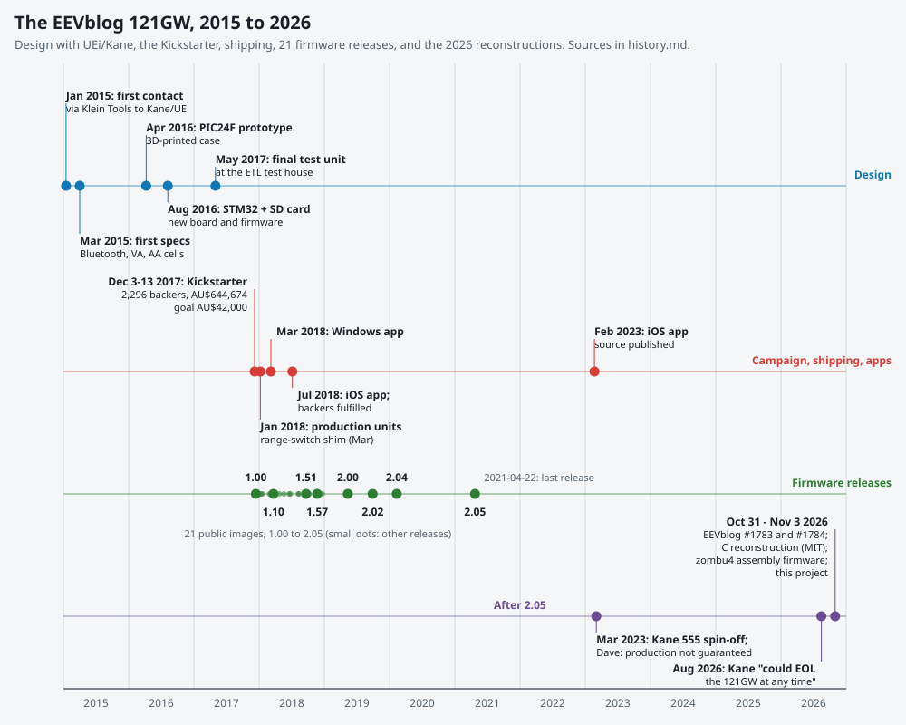

# A history of the EEVblog 121GW

This document tells the story of the EEVblog 121GW multimeter from the first contact with its manufacturer in 2015 to the reverse-engineering projects of 2026: who designed it, how it was funded and shipped, the hardware problems and how they were handled, the apps, the firmware releases, and the end of updates. Every entry carries its source. Firmware details per release are in [versions.md](versions.md), not repeated here.

## Main findings

- **EEVblog specified it; UEi designed and built it.** The meter was "designed by Dave & UEI": "The design work was primarily done by UEI, but with a great deal of design input and direction from Dave. The meter is manufactured in South Korea" [KS]. UEi/Kane paid for the development [DH @ 59:36-59:46] and wrote the firmware, which stayed closed [LC @ 31:02-31:17].
- **Two and a half years from first contact to backers.** Contact in January 2015 [DH @ 4:07], a PIC24F prototype, a switch to an STM32 with an SD card in mid 2016, the final test unit in May 2017, and a 10-day Kickstarter in December 2017 that raised AU$644,674 from 2,296 backers against an AU$42,000 goal [KS].
- **The SD card was an accident that paid off.** It was added only because UEi changed processors, and Dave called the SD firmware update "the best decision we ever made" [DH @ 38:58-39:37].
- **Shipping took until mid 2018** because of a range-switch problem (fixed with a shim and a revised detent spring), late cases and probe supply [Dev, KS updates].
- **Firmware: 21 public releases, from 1.00 (the first production meters, around the turn of 2018) to 2.05 (2021-04-22)**, almost all fixes found by forum users. No release has followed 2.05; in 2026 Dave said Kane could end production at any time [FW, 2026-08-13].
- **2026: the firmware is rebuilt from the binary.** EEVblog #1783 (2026-10-31) tried AI reverse engineering, #1784 (2026-11-03) published a working C reconstruction, zombu4 published an assembly rewrite, and this project documented and fixed 2.05's defects.

## Sources

| Tag | Source |
|---|---|
| DH | "121GW Development History", EEVblog2, YouTube `e9cpKN69Avk`, uploaded 2018-10-03 (the backers' reward video) |
| LC | "EEVblog 121GW Multimeter Kickstarter Live Chat", EEVblog2, `WXA_8WaqrCw`, 2017-12-06 |
| KS | Kickstarter page `kickstarter.com/projects/eevblog/eevblog-121gw-multimeter`, Wayback captures 20190415140520 (campaign), 20190920202839 (rewards), 20221205203354 (funding period); updates #9 (20190415140157), #28 (20190411132351), #31 (20190411132337) |
| KSA | Forum thread "ANNOUNCEMENT: 121GW Multimeter on Kickstarter" (eevblog.com/forum, topic 99833) |
| Dev | Forum thread "EEVBlog 121GW Discussion thread" (topic 101816) |
| Iss | Forum thread "EEVblog 121GW Multimeter Issues" (topic 101807) |
| FW | Forum thread "EEVBlog 121GW Multimeter Firmware Details" (topic 102038) |
| KI | Forum thread "121GW Known issues" (topic 219634) |
| Hack | Forum thread "121GW multimeter firmware hack to prevent remembering last mode" |
| M-date | 121GW User Manual, by its "Last Revised" date (11 December 2017 via Wayback 20171215085333; 24 January 2018 via 20180827194451; 8 February, 8 August and 27 September 2019; 1 March 2020; 3 March 2025) |
| CL | The manual's FIRMWARE VERSION section (changelog), as collected in [versions.md](versions.md) |
| GH | GitHub repository metadata (creation dates) |
| YT id | Other YouTube videos, by id and upload date |

Video times are positions in the video (auto-captions). Forum dates are post dates. "Unverified" marks anything taken from a single secondhand source.

## 1. Idea and design (2015-2017)

| Date | Event | Source |
|---|---|---|
| Before 2015 | Dave rebadged Brymen's BM235 and asked Brymen about a custom meter; they were not interested. | DH @ 1:01-1:32 |
| January 2015 | Through Klein Tools (then part-owner of UEi) Dave is put in touch with Kane Test, whose Korean arm (Finest, later wholly owned by Kane) designs and makes the meters. | DH @ 3:17-6:19 |
| March 2015 | First specification talks: AA batteries, power measurement, low burden voltage; "Bluetooth was from day one". | DH @ 9:36-10:20 |
| April-June 2015 | Display and case iterations; seven-segment LCD chosen over a dot-matrix display; "by June 2015, we had the look and feel of the meter". | DH @ 11:42-14:58 |
| July-August 2015 | Contract at a fixed buy price; processor discussion (MSP430 considered, long battery life a requirement). | DH @ 20:51-21:54 |
| 2015-2016 | The HY3131 chipset is chosen, with VA instead of true watts, to keep the cost down. | DH @ 19:45-20:07 |
| 2015-2016 | A Microchip PIC24F is chosen to drive the LCD directly; UEi's standard input jacks are used. | DH @ 25:25-26:13 |
| 2016-04-11 | The first 3D-printed prototype in a printed case arrives. | DH @ 32:05-32:19 |
| mid 2016 | UEi wants to change processors; Dave picks an ST ARM part. With spare pins Dave proposes a microSD card for logging and firmware updates. UEi redesigns the board, processor and firmware "from scratch" with a bootloader in under two months. | DH @ 37:25-41:47; YT `jnPsaEalfSw` (2016-08-04) @ 0:39-1:20 |
| 2016-08-04 | Video of the STM32 prototype. | YT `jnPsaEalfSw` |
| 2016-11 to 2017-01 | Prototype bugs filmed: VA mode reading jumps (2016-11-21), settling time and calibration averaging (2017-01-26); EMC issues. | YT `4ILRYVAICn8`, `_HVMtHrZsU0`, `Bs0N0udydj4`; DH @ 42:50-44:16 |
| 2016-2017 | Design upgrades: an ADR3412 voltage reference, an Analog Devices AD8436 true-RMS converter (the HY3131's own RMS was limited to about 1.5 kHz), Brymen gold-plated probes. | DH @ 48:22-50:15 |
| 2017-05-02 | Final test unit (date code 2017 05 02) at the test house, after a change in the 10 A path; custom carry case. | YT `h4kxdhxDcq0` (2017-05-29), `R5Jslt5F930` (2017-06-01) |
| 2017-06-16 | Video of the SD firmware update: hold HOLD and MEM while switching on, then SETUP. | YT `96XE5Ye1q6I` @ 0:26-0:45 |

The hardware as shipped [KS; M-11 December 2017]: Hycon HY3131 measurement chipset, ST STM32L152 (ARM Cortex-M3), BLE112 Bluetooth LE module, microSD card for logging and firmware, AD8436 true RMS (>100 kHz), MAX4238 for low burden voltage (the chip in EEVblog's µCurrent), ADR3412 8 ppm reference, 4 x AA (500+ h), dual 50,000-count display, 600 V CAT III with ETL listing, 15 V diode test, VA power, burden-voltage display, open schematic, ST-LINK header.

## 2. Kickstarter (November-December 2017)

| Date | Event | Source |
|---|---|---|
| 2017-11-23 | Kickstarter video: "developing this for the last two years in conjunction with UEI". | YT `5cVrGcdV5JA` @ 0:00-0:11 |
| early Dec 2017 | 40-50 early units offered to EEVblog Patreon and forum supporters; the web store crashed under demand. | YT `fWhnT8FVR5Y` (2017-12-04) @ 0:24-0:56 |
| 2017-12-03/04 | Campaign launches (launched_at 2017-12-03 23:19 UTC, 2017-12-04 in Sydney); "100% funded already!" within hours. | KS 20221205203354; KSA, EEVblog, 2017-12-04 |
| 2017-12-06 | Live chat: UEi writes the firmware, which will not be open source; the app is open source; bootloader only drives SD, switch, buttons and LCD. App repo `EEVblog/EEVblog-121GW` (GPL-3.0) created. | LC @ 31:02-32:41, 50:27-50:56; GH |
| 2017-12-13 | Campaign ends (10 days). AU$644,674 pledged of AU$42,000 by 2,296 backers. Tiers: AU$5 (74), "Great Scott!" early bird AU$250, first batch in December (450), "Johnny B. Goode" AU$265, second batch, March 2018 (1,757). | KS |

No stretch goals appear in any capture. The kit: meter, Brymen BM235 gold-plated probes, thermocouple, custom case [KS FAQ]. EU backers were reshipped by Welectron in Germany [KS update #9].

## 3. Manufacturing and shipping (December 2017-July 2018)

| Date | Event | Source |
|---|---|---|
| 2017-12-20 | "Last minute firmware and calibration issues have delayed the meters a few weeks"; UEi plans 1,000 units by January 31 and 1,000 by February 28. | KS update #9 |
| December 2017 | A calibration bug on a high resistance range is found while calibrating the final units. | LC @ 5:09-5:21 |
| 2018-01-06 | The first production meters reach EEVblog (box of 32; boot shows the factory firmware). | YT `liXaHJLn6Ps` |
| January 2018 | Range-switch intermittent contact and wobble reported; US meters held back at Kane Test (UEi) for the fix and shipped directly from there. | Dev, EEVblog, 2018-01-24 |
| 2018-03-07 | "We are now confident in the shim and revised indent spring solution for the range switch." Existing backers get a switch and shim kit; Windows app in the Microsoft Store. | Dev, EEVblog, 2018-03-07 |
| 2018-07-05 | Most countries fulfilled from Sydney; US and EU waited for cases; Brymen probe stock ran out ("we sucked up their entire worldwide supply"), so a few dozen got Kane leads; iOS app released. | KS update #28 |
| 2018-07-16 | EU meters arrive at Welectron. | KS update #31 |

## 4. Hardware problems and revisions

| Date | Problem and handling | Source |
|---|---|---|
| 2018-01 to 2018-03 | Range switch: a marginal PCB-thickness tolerance; fixed by a shim and a revised detent spring. "Most people didn't have an issue, it's was a statistical thing." | Dev, 2018-03-07; DH @ 55:21-55:33; KI thread, EEVblog, 2019-11-26 |
| 2018-08-22 | MΩ range drift traced by UEi to the 1N4007 diodes D7 and D8, to be replaced by a single TVS. | Iss, EEVblog, 2018-08-22 |
| 2018-08-29 | Fresh lithium cells overvolt the reference on the diode and Ohm ranges; the manual got a warning (manual revision 30/08/18). | Iss, EEVblog, 2018-08-29; M-2019 changelog |
| 2018-12 | Later boards use a different multiplexer and extra clamping (forum teardown); "the previous chip passed all UL CAT III standard tests just fine". | Dev, EEVblog, 2018-12-03 |
| 2018-12-04 | The carry case becomes an optional accessory. | M-2019 changelog |
| 2023-03-04 | The Brymen probes were replaced by Kane probes after the campaign, for supply and packing reasons. | Hack, EEVblog, 2023-03-04 |

## 5. Apps and accessories

The Bluetooth app was EEVblog's own, written by David ("Seppy" on the forum), whom Dave paid a full engineering wage for it [LC @ 15:49-15:58]. It is open source and cross-platform; UEi's existing app was rejected [LC @ 65:39-66:15].

| Date | Event | Source |
|---|---|---|
| 2017-12-06 | `EEVblog/EEVblog-121GW` on GitHub (GPL-3.0), nightly builds on GitLab. Android and Windows tested at launch; iOS, Mac and Linux "not tested yet". | GH; KS (Risks) |
| 2018-03 | Windows app in the Microsoft Store; firmware 1.10 replaces the ASCII Bluetooth packet with a binary one after forum criticism. | Dev, EEVblog, 2018-03-07 and 2018-03-20; [versions.md](versions.md) |
| 2018-07-05 | iOS app released on the App Store. | KS update #28 |
| 2023-02-22 | Dave publishes the iOS app source (GitHub `EEVblog/121GW-App-Apple-IOS`, also GitLab); the GitHub copy is no longer online (unverified when it went). | Dev, quoted by bicycleguy, 2023-02-26; GH (404 on 2026-11-03) |
| 2026-08-13 | "That's why I haven't gotten back into updating the apps, just relying on the 3rd party Meteor app now." | FW, EEVblog, 2026-08-13 |

## 6. Firmware releases (2017-2021)

The 21 public releases are documented one by one in [versions.md](versions.md). The outline:

| Period | What happened | Source |
|---|---|---|
| 2017-12 to 2018-03 | 1.00-1.10: calibration file save/load, buzzer setting (1.04), autorange speed, VA fixes, the binary Bluetooth packet (1.10). | CL; [versions.md](versions.md) |
| 2018-01 | tpw_rules reverse engineers 1.02 and patches the autorange delay; Dave tests it on video. | GH `tpwrules/121gw-re` (2018-01-23); YT `3MD88EYLdQQ` (2018-01-25) |
| 2018-04 to 2018-11 | 1.15-1.57: OFL display, VA accuracy, °C/°F and 24-bit values in the packet, M Ω autorange loop, 500 VA range (manual 11/09/18). | CL |
| 2018-12-08 | EEVblog and Kane set up a shared git so EEVblog gets "full visibility on all firmware changes"; until then "we have almost no real visibility into their internal firmware environment". | FW, EEVblog, 2018-12-08 |
| 2019-01-08 | David (Seppy): "I'm getting involved with the firmware (previously I could only communicate problems)". | Dev, Seppy, 2019-01-08 |
| 2019-05 to 2019-09 | 2.00 (faster autoranging), 2.01 withdrawn, 2.02. | CL; YT `q4gXnpFPFzQ` (2019-06-02) |
| 2019-05-10 | After a "121GW Stock Clearance!" mailing: "It's not EOL, I'll be selling this meter for many more years to come." | Dev, EEVblog, 2019-05-10 |
| 2020-02-10 | 2.04 fixes long-run SD logging (UEi had staged rows in the data EEPROM, as ST's library suggested; now RAM). | Iss, EEVblog, 2020-02-10 |
| 2021-04-22 | 2.05, "Improved LFP response": "They changed the low pass filter curve to better match the performance of the Fluke 289". The last release. | CL; Dev, EEVblog, 2021-04-22 |

## 7. After the last release (2021-2026)

| Date | Event | Source |
|---|---|---|
| 2021-09-06 | The 121GW forum threads are unpinned: "now, meh, it's just another meter". | Dev, EEVblog, 2021-09-06 |
| 2023-03-04 | Kane's own 555 meter is a spin-off of the 121GW ("doesn't have the 15V diode mode", adds an energy-measurement chip). Dave: "I work on the assumption that at any time they will say sorry, we just don't want to make it any more. So doesn't make sense to put effort into custom firmware." | Hack, EEVblog, 2023-03-04 |
| 2023-10-11 | EEVblog 1571 includes a 121GW repair. | YT `zTsGSEX5Klk` |
| 2025-02-27 | EEVblog 1671 on continuity latching uses the 121GW as one of the meters not fooled by a 0.1 µF in-circuit capacitor. | YT `9lC-k5yU9W4` @ 9:56-10:09 |
| 2025-02/03 | Manual revisions of 24/02/25 and 03/03/25 (55,000 counts, battery details, pulse width). | M-3 March 2025 |
| 2026-08-13 | "Kane have kinda indicated that they could EOL the 121GW at any time." No new firmware expected. | FW, EEVblog, 2026-08-13 |

## 8. 2026: the firmware rebuilt

| Date | Event | Source |
|---|---|---|
| 2026-10-31 | EEVblog 1783 "Can AI Reverse Engineer the 121GW Multimeter Firmware?": Cursor with the "Reverse Engineer Anything" MCP and Claude Opus 5.5, from the binary and the schematic. The resulting repos `EEVblog/121GW-Firmware-Claude` and `EEVblog/121GW-Firmware-Cursor` are marked as not working, for education only. | YT `BEKRoZj6otc` (description and chapters; captions not retrieved); GH |
| 2026-10-31 | rosenrot00/Open121GW (GPL-3.0), a reverse-engineering and UART test project. | GH |
| 2026-11-01 | zombu4/121GW-Open-Firmware: an open replacement firmware in hand-written Thumb-2 assembly with an emulator, and a list of 56 issues in the stock firmware (OF-01 to OF-56). Custom non-commercial license. | GH |
| 2026-11-03 | EEVblog 1784 "Claude Code Reverse Engineer 121GW Firmware SUCCESS!": `EEVblog/121GW-Multimeter-Firmware-RE` (MIT), the bootloader and application 2.05 reconstructed in C, equivalent in emulation and tested on a meter, including Bluetooth. | YT `2tUC0DuPjaM` (description); GH |
| 2026-11-03 | This project's findings on 2.05 (defects, fixes, emulator) are posted to the Firmware Details thread. Its firmware fork is based on EEVblog's MIT reconstruction ([bugs.md](bugs.md), [research-log.md](research-log.md)). | FW, 2026-11-03 |

## Open questions

- The exact dates of the first PIC24F prototype and of the ETL certification were not found in a primary source.
- When the iOS source repository left GitHub.
- Kickstarter updates for backers only (for example #4) and the campaign comments are not in any archive capture.
