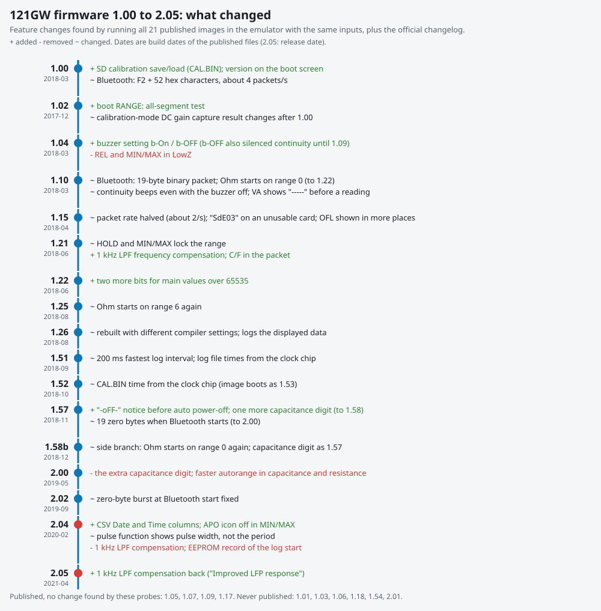

# Firmware history: all 21 releases, 1.00 to 2.05

This document covers every official 121GW firmware release EEVblog published, from 1.00 to 2.05. For each one it gives the release date, the official changelog text, and what we checked ourselves: each image ran in the emulator with the same 261 scenarios, and each image's code was compared with its neighbors. It lists features added, changed and removed, Bluetooth format changes, and bugs where we know when they appeared. Summary tables follow the per-version sections. For the meter's wider history (design, Kickstarter, hardware, apps) see [history.md](history.md).



## Main findings

- **One working measurement feature was removed and later restored.** 2.04 dropped the 1 kHz low-pass-filter frequency compensation (the function became a 6-byte stub that returns its input). With the filter on, 2.04 shows ten times the real value at every frequency. 2.05, "Improved LFP response", is that same code put back: it is identical to 2.02's. Emulated and checked in the code.
- **The Bluetooth packet changed format once, in 1.10.** 1.00-1.09 send `F2` followed by 52 ASCII hex characters and CR LF. From 1.10 on the meter sends a 19-byte binary packet. An app written for one format cannot read the other. In 1.15 the rate dropped from about 4 to about 2 packets per second. 1.57-2.00 send 19 stray zero bytes when Bluetooth turns on, and 2.02 stopped that. Emulated.
- **Other removals are small:** REL and MIN/MAX in LowZ went away in 1.04, probably as bug removals. The pulse function shows the pulse width instead of the period from 2.04 on (a fix, but the period reading is gone). One capacitance digit existed only in 1.57-1.58. From 1.10 on, "buzzer off" no longer silences continuity. The EEPROM record of the logging start time was dropped in 2.04. Everything else 1.00 could do is still in 2.05.
- **2.05 is 2.04 plus one function.** Of 790 functions in 2.05, 787 are the same code moved to a new address. The only changes are the LPF compensation, the version digits and a dead C-runtime exit path. Every known 2.05 defect outside the LPF path was already in 2.04 ([bugs.md](bugs.md)).
- **1.26 was rebuilt with different compiler settings.** From 1.26 on, every function matches 2.05 exactly in normalized form. Before it, similarities are 0.4-0.9, so code comparison is weak evidence for versions before 1.26 and the emulator results carry those versions.
- The image published as 1.52 reports **1.53** on its boot screen.

## Evidence tags

| Tag | Meaning |
|---|---|
| **E** | Emulated: the image ran in `tools/emu_run.py` with the same inputs as every other version. LCD glass, buzzer, Bluetooth bytes, SD card files, EEPROM writes and the HY3131 configuration are hardware-level outputs, so they compare directly across versions. |
| **C** | Code comparison: static diff of the images (`tools/versions/codediff.py`, `presence.py`; for 2.04/2.05 a full Ghidra function match, `tools/v204/`). |
| **CL** | Official changelog or manual text, quoted verbatim. |
| **M** | Seen on a production meter. |

"Built" dates are the timestamps of the `.bin` inside EEVblog's zip (the build or packaging date). "Posted" dates come from the EEVblog forum thread "EEVBlog 121GW Multimeter Firmware Details" and Wayback Machine captures of the product page. Changelog text is from the 121GW user manual's FIRMWARE VERSION section (revision of 3 March 2025, and 27 September 2019 for the 2.02 line, which later manuals dropped).

## How the versions were compared

1. `tools/versions/probe.py OUTDIR EEVBlog*.bin --jobs 8` runs 261 scenarios per image: every dial position, MODE cycles, every key short and long, SETUP walks and edits, every key held at boot, SD calibration save and load, logging on FAT32, FAT16 and blank cards, Bluetooth on and off with all eight remote keys and the clock-set frame, LPF at 10/50/1000 Hz, PEAK, AC+DC, dBm, overload, negative input, low battery, temperature, jacks, dial turns, auto-hold, MIN/MAX, continuity, diode 15 V, buzzer off, capacitance and VA. That is 5,481 runs, about 3 hours at 8 in parallel.
2. `tools/versions/matrix.py OUTDIR [--delta]` groups consecutive versions whose outputs are identical for each scenario. The boot-screen version text is masked.
3. `tools/versions/codediff.py` splits each image into code pieces at every `push {.., lr}`, normalizes them (all numbers and addresses masked) and reports pieces that are gone or new between consecutive versions. Each piece is named through its best match in 2.05. `presence.py` looks up every piece of one version in all the others.
4. 2.04 against 2.05 got a full Ghidra 12.2 project and a function-by-function match ([2.04 to 2.05](#205)).

Noise to ignore in the matrix: half-drawn digits at a sample time (a settle whose timing shifts by a few milliseconds between builds), the clock colon blinking, and buzzer on-times differing by 1-3 ms.

Limits: the HY3131 model gives a fixed AD1 value and models no analog front end, so behavior that depends on real analog signals (LowZ automatic AC/DC, VA products and burden, true RMS) is not compared. Auto power-off timing (30 emulated minutes per run) and the 1.51 log-interval change (208 ms to 200 ms) were not run per version. Probes that preload EEPROM bytes use 2.05's layout; the layouts matched in every version except that 1.00-1.02 have no buzzer byte.

---

## 1.00

- **Built** 2018-03-07 (zip). Probably repackaged when the product page was set up in March 2018: 1.02's zip is older (2017-12-28). Product page link "EEVBlog1_00".
- **Image** 117,256 B, boot screen "U-1.00" (E). 470 function prologues (C).
- **Changelog** (CL):
  ```
  1.00 Added support for exporting and importing calibration
  data to/from SD card.
  Displays version number on boot.
  ```
- **What we found:** the baseline. Every dial position, MODE cycle, SETUP page (no buzzer page yet), boot-key function, the SD calibration file (CAL.BIN, 1,200 B), logging to `YYMMDDNN.CSV`, Bluetooth remote keys and the F8 clock-set frame, auto-hold, MIN/MAX/AVG, REL, 1 ms PEAK, 1 kHz LPF (a plain reading, no x10 path), AC+DC, dBm, burden display, temperature units, continuity modes, diode 15 V and the meter ID are all present (E).
- **Bluetooth:** `F2` + 52 ASCII hex characters + CR LF, about 4 packets/s (E).
- **Differences from later versions (E):** REL and MIN/MAX are accepted in LowZ. The boot-time RANGE key shows only the version, not all segments. The VA position shows 0.0000 before a reading. The pulse function shows the period. In calibration mode the DC gain capture shows 5.0000 and writes EEPROM 0x72-0x77, where 1.02 and later show 0.7813 and write only 0x72-0x73. Without a real meter we cannot say which is right.
- **Logging start record:** a long MEM writes the mode to EEPROM 0x4B8 and a start time to 0x4C0 onward (E). The save is broken: every byte after the first goes to 0x4C1 (`adds r0, r4, #1` each time), so only the year and the seconds survive (C). This lasts until 2.02.

## 1.02

- **Built** 2017-12-28. Published as "EEVBlog1_02" although the manual lists it as an internal version. Byte-identical to the image in tpwrules/121gw-re (`binaries/EEVBlog-102.bin`).
- **Image** 117,848 B, "U-1.02" (E).
- **Changelog** (CL): `1.02 Internal version.`
- **Added:** boot-time RANGE lights all segments (E). A 958-byte routine that becomes 2.05's `Record_Snapshot` appears (C).
- **Changed:** the calibration-mode DC gain capture result (see 1.00). The manual's 1.03 entry, "Fixed possible import export calibration bug", may relate, but 1.03 was never published (E, CL).
- **Bug seen:** REL in LowZ is still accepted, but the reading after it looks wrong (AC icon, 300.0, not relative), which suggests why 1.04 removed it (E).
- **Not a change:** 1.02-1.09 reach OFL on a 10x overload about 3 s later than 1.00 and 1.10+. The final display is the same (autorange timing) (E).

## 1.04

- **Built** 2018-03-07. Product page.
- **Image** 118,536 B, "U-1.04" (E).
- **Changelog** (CL):
  ```
  1.04 Resistance auto-ranging speed improved.
  Can now turn beeper off.
  Negative VA values now readable.
  ```
- **Added:** SETUP buzzer page b-On / b-OFF, EEPROM 0x1E (E, CL). A new 836-byte routine with no 2.05 counterpart (C).
- **Removed:** REL in LowZ and MIN/MAX in LowZ. Both now give the double "not available" beep (E). Probably dropped as bugs (see 1.02).
- **Behavior:** with the buzzer off, continuity is silent too. This holds for 1.04-1.09 only (E).
- **Bug seen (1.04-1.09):** an input every other version shows as 20.000 MΩ shows as 1.9985 MΩ (Ohm range table or calibration path) (E).

## 1.05

- **Built** 2018-03-07. Product page.
- **Image** 118,732 B, "U-1.05" (E).
- **Changelog** (CL):
  ```
  1.05 Further improved auto-ranging speed.
  Improved Low-Z measurement up to 20KHz.
  ```
- **What we found:** no code piece added or removed (476 pieces before and after), so the changes are inside existing functions (C). The emulated outputs group with 1.04-1.09 (E). LowZ above audio frequencies depends on the analog front end, which the emulator does not model.

## 1.07

- **Built** 2018-03-05. Product page.
- **Image** 120,024 B (+1,292 B), "U-1.07" (E).
- **Changelog** (CL): `1.07 Improved VA mode over-estimation error.`
- **What we found:** no piece-level change (C); the growth is inside existing functions. Emulated outputs group with 1.04-1.09 (E). VA arithmetic with real V and I is outside what the model gives (VA shows 0).

## 1.09

- **Built** 2018-03-14. Never linked from the product page. The zip is on EEVblog's server and was found through the Wayback Machine's index.
- **Image** 120,232 B, "U-1.09" (E).
- **Changelog:** none in any manual.
- **What we found:** no piece-level change from 1.07 (C). It is the last version with the text Bluetooth packet (E).

## 1.10

- **Built** 2018-03-22. Product page.
- **Image** 119,552 B (-680 B), "U-1.10" (E).
- **Changelog:** none in any manual.
- **Bluetooth format change:** the text packet builder is gone (12 pieces removed). The binary sub-field builders appear (2.05's `BLE_PacketHeader`, `BLE_SubBattery`, `BLE_SubContrast`, `BLE_SubYear`, `BLE_SubBurdenFlag`, `BLE_SubFrequency`, `BLE_SubBurden`) (C). The meter now sends the 19-byte binary packet: `F2`, fields, XOR check byte. Both formats carry the same fields (E).
- **Changed (E):** continuity beeps even with the buzzer off (one 6.3 s tone on a short); only key beeps obey b-OFF from here on. The VA position shows "-----" before a reading instead of 0.0000. The Ohm position starts on range 0, not range 6 (1.10-1.22; again in 1.58). The 1.9985 MΩ reading of 1.04-1.09 is gone.

## 1.15

- **Built** 2018-04-20. Posted by 2018-05-17.
- **Image** 121,540 B, "U-1.15" (E).
- **Changelog** (CL):
  ```
  1.15 Improved display to show OFL in appropriate sections,
  fixed lookup table bug with various range.
  ```
- **Added:** an 850-byte routine that is 2.05's `ACFreq_CorrectAcv0` (the frequency correction for the lowest ACV range) (C). Logging onto an unusable card now shows "SdE03" instead of silently showing MEM (E).
- **Bluetooth:** the packet rate halves, from about 4 to about 2 per second (E).

## 1.17

- **Built** 2018-05-22. Posted 2018-05-24, without a changelog at first.
- **Image** 127,864 B (+6,324 B), "U-1.17" (E).
- **Changelog** (CL): `1.17 Improved accuracy of voltage measurement in AC and DC VA modes.`
- **Added:** a 990-byte routine with no 2.05 counterpart. It lasts until 2.00 and is replaced in 2.02 by the current `VA_VoltageCorrect` (C). This matches the changelog's VA voltage line, though we did not check the arithmetic against real VA inputs.

## 1.21

- **Built** 2018-06-15. Posted the same day.
- **Image** 132,312 B, "U-1.21" (E).
- **Changelog** (CL): `1.21 Added support for ◦C and ◦F in the Bluetooth packet.` (the manual's degree signs)
- **Added:** the 1 kHz LPF x10 path with frequency compensation. The 856-byte routine that is 2.05's `ACFreq_LpfCompensate` appears (similarity 0.95 to 2.05) (C). With the filter on, readings are now divided back by 10 and corrected for the filter's droop between 20 Hz and 6 kHz. Below 20 Hz, or before the first frequency result, the reading stays x10 (E). This is zombu4's OF-26, still in 2.05.
- **Changed:** HOLD and MIN/MAX lock the range (the AUTO icon goes off while held), like RANGE (E). New routines `MinMax_Update` and `MinMax_RedrawIfHold` (C).
- **Bluetooth:** the temperature unit field per the changelog (CL; not checked separately).

## 1.22

- **Built** 2018-06-20. Posted by 2018-06-22.
- **Image** 132,352 B, "U-1.22" (E).
- **Changelog** (CL):
  ```
  1.22 Added 2 more bits of data for the main data to
  accommodate values over 65535.
  ```
- **What we found:** no piece-level change (C). The Bluetooth main-value extension is from the changelog (not checked separately). This is the last version, apart from 1.58, that starts Ohm on range 0 (E).

## 1.25

- **Built** 2018-08-07. Posted the same day with a new manual.
- **Image** 132,772 B, "U-1.25" (E).
- **Changelog** (CL):
  ```
  1.25 Auto-ranging loop in M Ohms range resolved.
  Burden Voltage glitch resolved.
  ```
- **What we found:** no piece-level change (C). Ohm starts on range 6 again from here (E).

## 1.26

- **Built** 2018-08-11. Posted the same day.
- **Image** 133,367 B, "U-1.26" (E).
- **Changelog** (CL): `1.26 Improved resistance range noise when logging.` EEVblog's forum note at release said the logger now records the displayed data instead of the bargraph data.
- **Rebuild:** from 1.26 on, constant data such as the CSV strings is stored compressed, and every function matches 2.05 exactly in normalized form. Before 1.26, the same functions score 0.4-0.9. The codediff's 27 "gone" and 28 "new" pieces at 1.25 to 1.26 are this rebuild, not feature changes: each new piece is a 2.05 function at 1.00 similarity (`HY_BuildConfig`, `Mode_ApplyChange`, `Log_Start`, `Log_StoreSample`, the SD driver, FatFs's `chk_mounted`, and others) (C). Emulated behavior is unchanged except where noted (E).

## 1.51

- **Built** 2018-09-21. Withdrawn from the product page by 2018-10-30. The file is still on the server.
- **Image** 134,207 B, "U-1.51" (E).
- **Changelog** (CL):
  ```
  1.51 208ms data logging interval -> 200ms.
  File date and time in file meta info corrected.
  DC+AC auto ranging loop issue resolved.
  Amp range sensitivity improved.
  AC mode frequency persistence issue resolved.
  VAC + LPF bargraph issue resolved.
  ```
- **Added:** `File_SetTimestamp` and FatFs `f_utime`. Log files now get their modified time from the clock chip (C, E). The created time stays FatFs's sample constant, 2006-02-09 22:30, in every version up to 2.05: `get_fattime` was never changed. Also new: `Board_ProbePF8` (reads the PF8 hardware-variant strap) and `Reading_FastPathAC` (C).
- **Not checked:** the 200 ms log interval (the probes log at 1 s).

## 1.52 (boots as 1.53)

- **Built** 2018-10-05. Posted by 2018-11-05.
- **Image** 134,399 B. The boot screen says **"U-1.53"** (E). Forum users noticed this in November 2018. Since 1.53 was never published under its own name, this image is both "1.52" and "1.53".
- **Changelog:** none in any manual. A forum user reported less 50 Hz noise in resistance mode.
- **Changed (E):** CAL.BIN also gets its modified time from the clock chip. The no-card "-Err-" after an SD calibration save comes later than before (more retries), but it still comes. No piece-level change (C).

## 1.57

- **Built** 2018-11-21. Posted the same day.
- **Image** 135,067 B, "U-1.57" (E).
- **Changelog:** none in any manual.
- **Added:** the power-off notice "-oFF-" shown for a second before auto power-off sleep (`App_OffNotice`), and FatFs `f_stat` (C).
- **Changed (E):** capacitance shows one more digit for the same input (" 2.457" nF instead of "  2.45"), in 1.57 and 1.58 only. This rests on the emulator's counter model.
- **Bluetooth bug introduced:** 19 zero bytes go out before the first packet when Bluetooth turns on (1.57-2.00). A strict framer drops them; a naive one may decode a bogus packet (E).

## 1.58 Beta

- **Built** 2018-12-20. Product page title "EEVBlog1_58 Beta". It was the current version until mid-2019.
- **Image** 135,647 B. The boot screen says "U-1.58", with no beta marker (E).
- **Changelog:** none in any manual.
- **What we found:** the Ohm position starts on range 0 again, which 1.57 and 2.00 do not, and the capacitance digit matches 1.57. `Mode_Cap_Poll` changed and `LCD_FlushBarOnly` is new (C). Probably built from a side branch.
- **Forum claim not reproduced:** "with 1.58 beta min/max/avg don't cycle". In emulation 1.58 cycles MAX, MIN, AVG like its neighbors (E).
- **Tool note:** a first pass reported `Cal_AcFreqWindow` (AC frequency-point calibration) missing in 1.58. That was an artifact of linear disassembly: the data before the function swallowed its prologue. The function is identical in 1.57, 1.58 and 2.00 ([tools/README.md](tools/README.md#fixes-we-had-to-make-to-the-tools)).

## 2.00

- **Built** 2019-05-10. On the product page by 2019-08-30.
- **Image** 140,931 B (+5,284 B), "U-2.00" (E).
- **Changelog** (CL):
  ```
  2.00 Improved the Auto-ranging reading speed in both capacitance and resistance ranges.
  ```
- **Changed:** the extra capacitance digit of 1.57-1.58 is gone (E). A new 908-byte VA routine is replaced again in 2.02 (C). The 19 stray Bluetooth zero bytes are still sent (E).

## 2.02

- **Built** 2019-09-27. Posted by 2019-09-28. 2.01 was never published (see [below](#versions-without-a-published-image)).
- **Image** 143,951 B, "U-2.02" (E).
- **Changelog** (CL, September 2019 manual only): `2.02 Fix to an issue with change in v2.01, do not use 2.01.`
- **Changed:** the VA voltage correction is rewritten into its current form, `VA_VoltageCorrect`. The 990-byte routine from 1.17 and 2.00's 908-byte routine are both gone (C).
- **Bluetooth fix:** no more stray zero bytes when Bluetooth turns on (E).
- This is the last version with the working 1 kHz LPF compensation before 2.05, and the last with the logging-start EEPROM record.

## 2.04

- **Built** (file date) 2020-02-10. Shipped on new meters by early March 2020. On the product page by December 2020. The image found on a production meter's SD card is byte-identical to EEVblog's download (M).
- **Image** 141,124 B (-2,827 B), "U-2.04" (E).
- **Changelog** (CL): `2.04 SD card logging issues resolved`
- **Added:** Date and Time columns in every CSV row (`Log_PutDate`, `Log_PutTime`, new) (C, E). The APO icon goes off during MIN/MAX (E).
- **Removed:**
  - **1 kHz LPF frequency compensation.** `ACFreq_LpfCompensate`'s slot holds a 6-byte identity stub (`movs r1,r0; movs r0,r1; bx lr`) (C). With the LPF on, the reading is ten times the unfiltered one at every frequency: 0.2 V AC shows 2.0000 V at 10 Hz, 50 Hz and 1 kHz (E). The changelog says nothing about it.
  - **The logging-start EEPROM record** (0x4B8 mode, 0x4C0 time) and the four functions that saved, loaded and used it (C, E). The new per-row date and time columns replace it. Whether the MEM recall view ever showed that time was not determined.
  - **The period in the pulse function.** It now shows the pulse's high time: 1,000 Hz at 50 % shows 0.4999 ms instead of 0.9999 ms, and 1,234.5 Hz at 25 % shows 0.2025 ms instead of 0.8100 ms (E). `Counter_PulseWidth` changed (C). The February 2025 manual revision says "Corrected Period measurement to Pulse Width". It is a fix, but the period is now only available as 1/frequency.
- **Bugs:** every 2.05 defect outside the LPF path is already here ([bugs.md](bugs.md)).

## 2.05

- **Released** 22 April 2021, per the manual. On the product page some time after 2021-05-13. This is the latest release. In August 2026 EEVblog said on the forum that no new firmware is expected.
- **Image** 144,616 B (+3,492 B), "U-2.05" (E). 488 prologues (C), 790 functions in Ghidra.
- **Changelog** (CL): `2.05 Improved LFP response (released 22/4/2021)` ("LFP" is the manual's spelling of LPF).
- **2.04 to 2.05, function by function** (C; both images in Ghidra 12.2, matched by normalized instruction streams, every match checked by its literals and call targets):

  | Class | Count | Meaning |
  |---|---:|---|
  | moved | 787 | same code at a new address; 13 only re-encoded (narrow/wide literal loads, one block reorder) with identical decompiles |
  | changed | 3 | `ACFreq_LpfCompensate` (stub to implementation), `LCD_DrawVersion` (204 to 205), `__iar_program_start` |
  | removed | 3 | the IAR exit chain after `main` (main never returns, so the linker dropped `exit`, its loop and the semihosting `__exit`) |
  | data | +2,592 B | three new 216-entry tables (frequency points, k for high and low amplitude); 12 new RAM words; every other table, string and font identical |

- **The restored compensation:** with the 1 kHz filter on in ACV or ACmV, the reading is multiplied by k/10000. k is interpolated over 216 frequency points from 20 Hz to 6 kHz and between a low- and a high-amplitude table. k is 1015 at 20 Hz (the x10 folded in), peaks about 3,815 near 820 Hz, is 729 at 4 kHz, and is 0 above 6 kHz. The normalized code is identical to 2.02's (C). Emulated with the filter on and 0.2 V AC: 2.04 shows 2.0000 V at 50 Hz and 1 kHz, 2.05 shows 0.2084 and 0.6930. 2.05 is compensating an analog roll-off the emulator does not model (E). Whether the boost (x2 at 300 Hz, x3.8 near 820 Hz) matches the real filter is a bench question.
- **Bug introduced in 2.05:** `reading * k` is a 32-bit signed product. On large over-range inputs with the LPF on it overflows: "-OFL" with a flipped sign, or at 2 kHz a plausible 2.0503 V instead of OFL (E). Below 20 Hz the x10 reading of 1.21-2.02 remains (OF-26).

## Versions without a published image

| Version | Evidence |
|---|---|
| 1.01 | Manual: "Internal version". Shipped on early meters (forum, January 2018). No image published. |
| 1.03 | Manual: "Fixed possible import export calibration bug." Not published (the upload URL returns 404). |
| 1.06 | Manual: "Internal version". |
| 1.18 | No changelog. Seen on one meter's boot screen (forum, July 2022). Probably a factory build. |
| 1.53 | The 1.52 download boots as 1.53 (E). |
| 1.54 | No changelog. Factory firmware on meters sold in November 2018 (forum). |
| 2.01 | Manual: "Resolved calibration glitch with V2.00 firmware. Reduces the Offset in the 50-ohm range." Never on the product page; the 2.02 entry says "do not use 2.01". |
| 2.03 | No evidence anywhere. |

---

## Summary tables

### Releases

| Version | Built / released | Size (B) | Boot screen | Changelog headline |
|---|---|---:|---|---|
| 1.00 | 2018-03-07 | 117,256 | U-1.00 | SD calibration export/import; version on boot |
| 1.02 | 2017-12-28 | 117,848 | U-1.02 | internal version |
| 1.04 | 2018-03-07 | 118,536 | U-1.04 | faster resistance autorange; beeper off; negative VA |
| 1.05 | 2018-03-07 | 118,732 | U-1.05 | faster autorange; Low-Z to 20 kHz |
| 1.07 | 2018-03-05 | 120,024 | U-1.07 | VA over-estimation |
| 1.09 | 2018-03-14 | 120,232 | U-1.09 | (none; never linked) |
| 1.10 | 2018-03-22 | 119,552 | U-1.10 | (none) |
| 1.15 | 2018-04-20 | 121,540 | U-1.15 | OFL display; lookup table bug |
| 1.17 | 2018-05-22 | 127,864 | U-1.17 | VA voltage accuracy |
| 1.21 | 2018-06-15 | 132,312 | U-1.21 | °C/°F in the Bluetooth packet |
| 1.22 | 2018-06-20 | 132,352 | U-1.22 | 2 more bits for main data |
| 1.25 | 2018-08-07 | 132,772 | U-1.25 | MΩ autorange loop; burden glitch |
| 1.26 | 2018-08-11 | 133,367 | U-1.26 | resistance noise when logging |
| 1.51 | 2018-09-21 | 134,207 | U-1.51 | 200 ms logging; file times; several fixes (withdrawn) |
| 1.52 | 2018-10-05 | 134,399 | **U-1.53** | (none) |
| 1.57 | 2018-11-21 | 135,067 | U-1.57 | (none) |
| 1.58 Beta | 2018-12-20 | 135,647 | U-1.58 | (none) |
| 2.00 | 2019-05-10 | 140,931 | U-2.00 | faster cap and resistance autorange |
| 2.02 | 2019-09-27 | 143,951 | U-2.02 | fixes 2.01 |
| 2.04 | 2020-02-10 | 141,124 | U-2.04 | SD card logging issues |
| 2.05 | 2021-04-22 | 144,616 | U-2.05 | improved LPF response |

### Bluetooth packet format

| Versions | Format | Rate | Notes (E unless marked) |
|---|---|---|---|
| 1.00-1.09 | `F2` + 52 ASCII hex characters + CR LF | ~4/s | the format the official app's master branch parses |
| 1.10 | 19-byte binary: `F2`, fields, XOR of bytes 0-17 | ~4/s | same fields as the text format |
| 1.15-1.17 | binary | ~2/s | |
| 1.21 | binary | ~2/s | temperature unit in the packet (CL) |
| 1.22-1.52 | binary | ~2/s | 2 more bits for the main value (CL) |
| 1.57-2.00 | binary | ~2/s | 19 zero bytes sent when Bluetooth turns on |
| 2.02-2.05 | binary | ~2/s | stray zeros gone |

In every version: F4 remote keys (all eight, short and long, echoed back) and the F8 clock-set frame work; other received frames (F0, F1, F3, F5, F9, FF, and F4 with unequal key bytes) are ignored (E). The packet layout is in [firmware/bluetooth.md](firmware/bluetooth.md).

### Features that changed across versions

Y = present and behaving as in 2.05. Columns group versions that behave alike for that row. All rows emulated unless marked.

| Feature | 1.00 | 1.02 | 1.04-1.09 | 1.10 | 1.15-1.17 | 1.21-1.26 | 1.51-1.52 | 1.57 | 1.58 | 2.00-2.02 | 2.04 | 2.05 |
|---|---|---|---|---|---|---|---|---|---|---|---|---|
| REL, MIN/MAX in LowZ | Y | Y (REL reading wrong) | - | - | - | - | - | - | - | - | - | - |
| SETUP buzzer page | - | - | Y | Y | Y | Y | Y | Y | Y | Y | Y | Y |
| Buzzer off also silences continuity | n/a | n/a | yes | no | no | no | no | no | no | no | no | no |
| Boot RANGE: all segments | - | Y | Y | Y | Y | Y | Y | Y | Y | Y | Y | Y |
| VA before a reading | 0.0000 | 0.0000 | 0.0000 | ----- | ----- | ----- | ----- | ----- | ----- | ----- | ----- | ----- |
| Ohm start range | 6 | 6 | 6 | 0 | 0 | 0 (1.21-1.22), 6 (1.25-1.26) | 6 | 6 | 0 | 6 | 6 | 6 |
| Logging on an unusable card | silent | silent | silent | silent | SdE03 | SdE03 | SdE03 | SdE03 | SdE03 | SdE03 | SdE03 | SdE03 |
| Log / CAL.BIN modified time from the clock | - | - | - | - | - | - | Y (CAL.BIN from 1.52) | Y | Y | Y | Y | Y |
| CSV Date and Time columns | - | - | - | - | - | - | - | - | - | - | Y | Y |
| Logging-start EEPROM record | Y (broken) | Y | Y | Y | Y | Y | Y | Y | Y | Y | - | - |
| HOLD and MIN/MAX lock the range | - | - | - | - | - | Y | Y | Y | Y | Y | Y | Y |
| APO icon off during MIN/MAX | - | - | - | - | - | - | - | - | - | - | Y | Y |
| 1 kHz LPF | plain | plain | plain | plain | plain | x10 + compensation | same | same | same | same | **x10, no compensation** | compensation |
| Pulse function shows | period | period | period | period | period | period | period | period | period | period | pulse width | pulse width |
| Capacitance digits (same input) | 2.45 | 2.45 | 2.45 | 2.45 | 2.45 | 2.45 | 2.45 | 2.457 | 2.457 | 2.45 | 2.45 | 2.45 |
| "-oFF-" before APO sleep (C) | - | - | - | - | - | - | - | Y | Y | Y | Y | Y |

### Features present in every version

All of these were emulated in every release and behave alike (apart from the rows above): the eight dial positions and their MODE cycles (LowZ; DCV/ACV/AC+DC; DCmV/ACmV/temperature; Hz/pulse/duty; Ohm/continuity/diode/capacitance; VA DC/AC; µA/mA/A DC/AC; µVA), every key short and long per position, the SETUP pages (temperature unit, battery, APO, LCD contrast, year, month-day, hour-minute, meter ID, log interval), the mode pages (ACV Hz and dBm, continuity modes, current burden, VA V/I and burden, diode 3/15 V), boot MEM (CAL.BIN save and load), boot SETUP (factory pages), boot MODE+REL (calibration mode), logging with a long MEM, auto-hold, MIN/MAX/AVG, REL and the µA/A long-REL zero trim, 1 ms PEAK, AC+DC, dBm, both temperature units, diode 15 V and the continuity modes.

### Removals

| # | What | Present | Gone | Evidence |
|---|---|---|---|---|
| R1 | 1 kHz LPF frequency compensation | 1.21-2.02 | 2.04 (restored in 2.05) | E, C |
| R2 | REL in LowZ | 1.00-1.02 | 1.04 | E |
| R3 | MIN/MAX in LowZ | 1.00-1.02 | 1.04 | E |
| R4 | Period display in the pulse function (now pulse width) | 1.00-2.02 | 2.04 | E, C, manual |
| R5 | One capacitance digit | 1.57-1.58 | 2.00 | E (counter model) |
| R6 | "Buzzer off" silencing continuity | 1.04-1.09 | 1.10 | E |
| R7 | EEPROM record of the logging start time | 1.00-2.02 | 2.04 | E, C |

R1 is the only removal of a working measurement feature. R2 and R3 went together in 1.04, the release that added the buzzer page. R4 trades one reading for another. R5 and R6 are reductions. R7 is internal bookkeeping that the CSV date and time columns replaced.

### Code size and structure

Image size grows from 117,256 B to 144,616 B with two dips: 1.09 to 1.10 (-680 B, the text packet builder replaced by the binary one) and 2.02 to 2.04 (-2,827 B, R1 and R7 removed, partly offset by the CSV date and time code). Anchored on 2.05, no 2.05 function is missing from an earlier version and then present again, except `ACFreq_LpfCompensate` at 2.04 (C).

### Bugs by origin

| Bug | First seen | Fixed | Evidence |
|---|---|---|---|
| LowZ REL reading wrong | 1.02 or earlier | 1.04 (feature removed) | E |
| 1.9985 MΩ for a 20.000 MΩ input | 1.04 | 1.10 | E |
| LPF x10 below 20 Hz (OF-26) | 1.21 | open in 2.05 | E |
| Stray 19 zero bytes at Bluetooth start | 1.57 | 2.02 | E |
| Logging-start record saves only the year and seconds | 1.00 | removed in 2.04 | C |
| LPF x10 at every frequency | 2.04 | 2.05 | E, C |
| LPF 32-bit product overflow on large over-range | 2.05 | open | E |
| Files created 2006-02-09 22:30 (`get_fattime` constant) | 1.00 (created time); modified time fixed in 1.51 | open in 2.05 | E, M |
| All other known 2.05 defects | 2.04 or earlier | open | C ([bugs.md](bugs.md)) |

## Open questions

- Which calibration-mode DC gain capture is correct, 1.00's or 1.02's.
- Whether the extra capacitance digit of 1.57-1.58 was meaningful.
- Whether 2.02 already extended auto power-off to 60 minutes in MIN/MAX, as 2.05 does.
- Whether the logging-start time was ever shown to the user before 2.04.
- Analog-dependent changes (LowZ above audio frequencies in 1.05, VA accuracy in 1.07 and 1.17, LPF droop) need a bench comparison, with 2.04 as a control for the LPF since it is otherwise the same code as 2.05.
